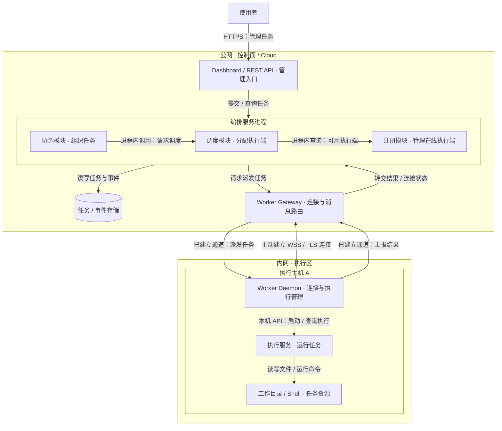
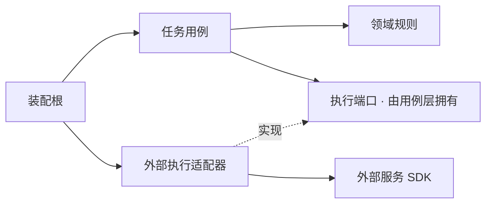
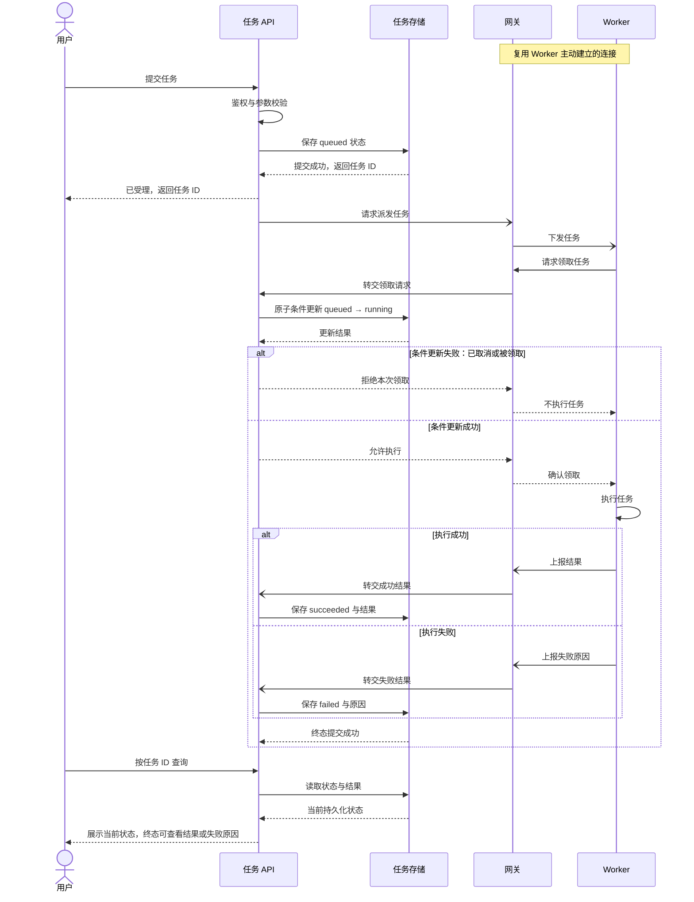
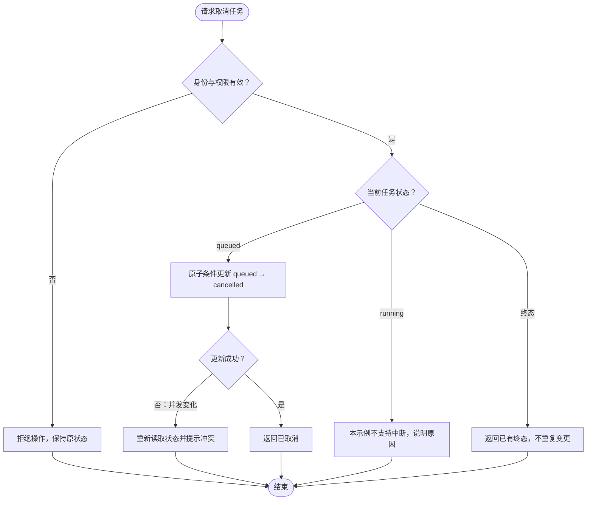
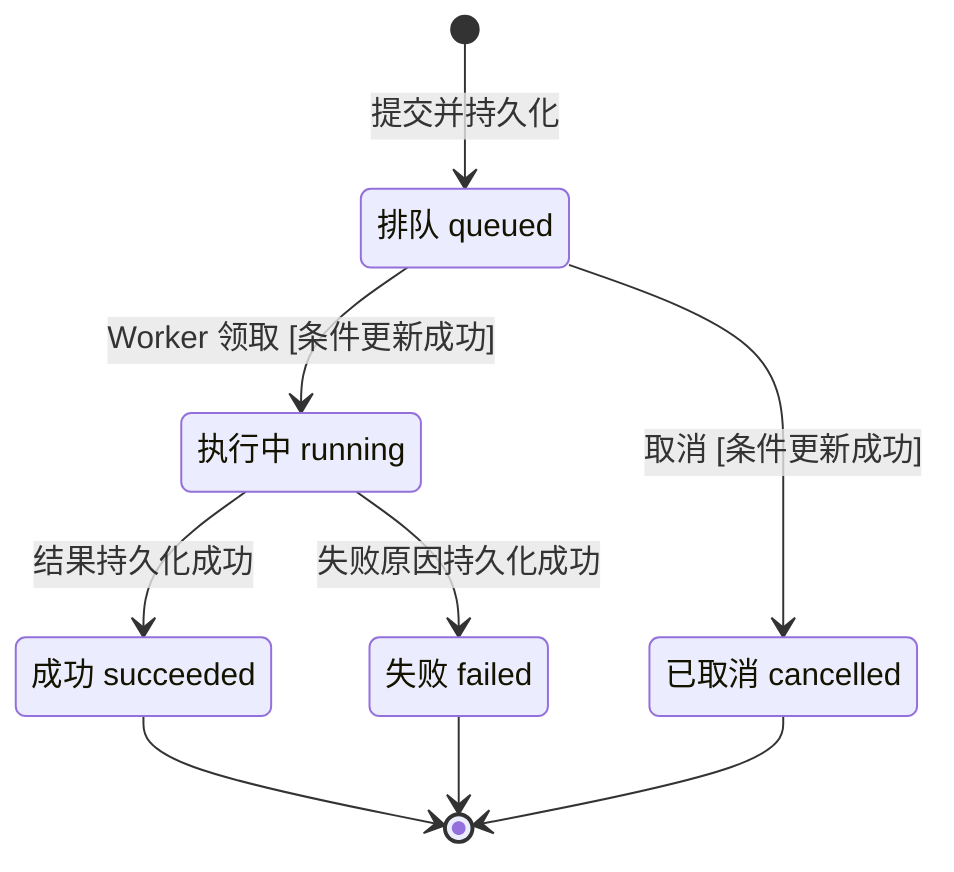
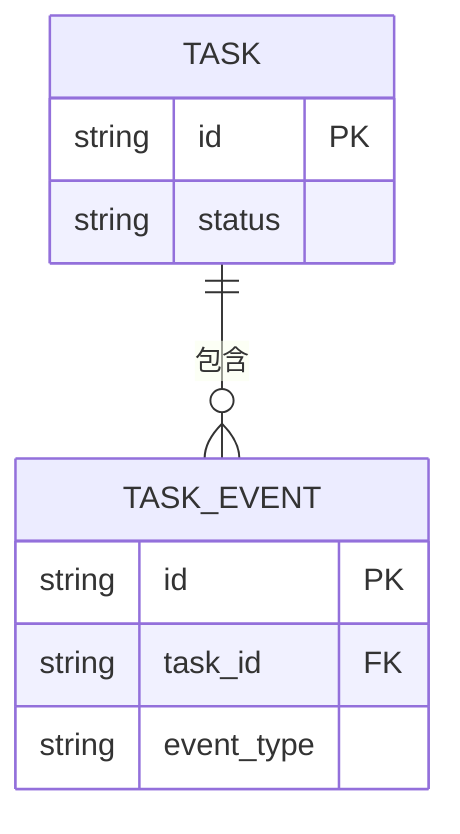

# 技术图示示例

以下均为虚构目标方案，只示范[图型选择与表达方法](../../../references/architecture/technical-diagrams.md)，不是本插件或某个项目的实际架构。采用时只保留本次需要的图，替换参与者、边界、协议、状态和失败语义；相邻正文补充源码/契约依据及相关 ARC/OUT，不将示例默认升级为项目要求。

## 分区、分层架构总览

问题：控制面与内网执行端各负责什么，如何通信？目标示意；外框分别代表网络区域和主机，控制面子框代表进程/运行单元，编排器内框代表同一进程中的逻辑组件。包含不表示调用，带标签的边表示运行通信或数据访问。图省略鉴权、重连与多副本细节。

读图结论：控制面管理任务与调度，执行端在内网运行任务；连接由 Worker 发起，任务通过已建立连接下发。网络连通不证明鉴权或权限已实现，实际设计仍需给出相关契约。

## 模块依赖图

问题：业务策略怎样避免依赖外部 SDK？目标示意；所有实线箭头表示源码依赖，虚线表示实现端口。装配根同时引用用例与适配器并完成注入，省略无关模块；图中方向不是请求执行顺序。

读图结论：用例通过自己拥有的端口调用外部能力；运行时会进入适配器，源码依赖仍朝向内层契约。

## 跨端协作时序图

问题：用户提交任务后，何时算受理，何时真正完成？目标示意；实线消息表示请求/调用，虚线表示响应，开放箭头表示不等待业务完成的异步消息。展示领取冲突和执行失败，鉴权失败、存储失败与连接中断另按实际契约展开。

读图结论：受理响应只证明排队记录已保存；查询时可能仍未结束，成功需执行完成且结果持久化。图中的异步派发不证明消息可靠交付；若存在可靠投递要求，设计必须补充丢失、重复及恢复机制。

## 条件决策流程图

问题：任务处于不同状态时能否取消？目标示意；菱形表示判断，边注明判断结果，矩形表示动作。这里只表达取消规则，实际参与者之间的调用顺序需另用时序图。

读图结论：仅排队任务可取消；并发启动可能使取消失败，条件更新防止覆盖已运行状态。这是示例规则，是否支持运行中取消由实际产品/执行契约决定。

## 生命周期状态图

问题：任务的合法状态转换是什么？与前两图一致的目标示意；框表示持久化状态，转换标注触发事件与条件，黑点表示初始或终止。没有出边的终态不允许原地重试，重试另建任务。

读图结论：取消只允许从 queued 进入 cancelled；终态不可回退。此图省略派发中间态与超时政策，真实项目不能据此推导其重试/恢复规则。

## 实体关系图

问题：任务和事件如何关联？目标示意；字段只列关系所需的键，连线注明基数；任务服务拥有这两类数据。完整字段、约束、删除和保留策略以项目 schema 为准。

读图结论：每个事件属于一个任务，一个任务可暂时没有事件。ER 图不说明事件投递顺序，也不证明采用事件溯源；需要这些保证时另写契约。
