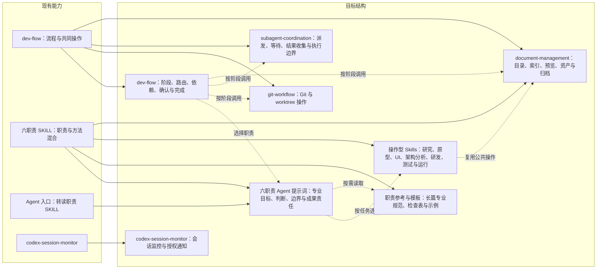

# Agent 职责与操作 Skills 重组规划

日期：2026-10-21。状态：用户授权范围已实施，源码和验收通过，Codex0.4.0已安装；实际安装结果见[总体进度](2026-10-21-agent-skill-reorganization/Progress.md)。基线：插件 0.3.0，总纲协议 0.29。配套：[迁移清单与实施安排](2026-10-21-agent-skill-reorganization/migration-plan.md)。

## 目标与边界

本轮按用户提出的五项方向重新组织能力：dev-flow 只维护流程；Git、subagent、文档管理分别成为独立 Skill；六职责的本质工作进入 Agent 提示词；职责使用的操作方法成为可复用 Skill。本规划不变更现有业务流程的确认、授权、Review、测试或交付标准，不将规划确认自动等同于后续实现授权。

流程回答“什么时候、由谁、依赖什么、怎样算完成”；Agent 回答“承担什么专业责任、依据什么判断、对什么结果负责”；Skill 回答“面对具体操作对象怎样执行、使用什么输入和工具、产生什么可核验结果”。技能可以跨职责复用，不再按一个职责对应一个 Skill 建目录。

项目资产保存当前项目的有效事实、确认和结果，例如技术版本、业务规则和实际模块地图。通用默认约定与项目当前事实分别维护，不将项目采用的配置复制进 Agent 身份。

独立建 Skill 的条件是：存在明确操作触发、可描述的输入输出、值得重复使用的方法/工具/资产，并且与相邻 Skill 的调用差异清楚。职责能力或文档篇幅本身不构成拆分理由；普通专业分析、取舍和写作允许由 Agent 直接完成。

## 调整前的基线与问题

调整前基线包含 dev-flow、六职责 Skill 和 codex-session-monitor，共八个 Skill。dev-flow 同时包含流程、Git、派发、文档目录、预览和归档。专业 Skill 混合职责说明、判断原则、具体方法和项目资产规则。

agents/dev_*.toml 与 adapters/kimi/agents/*.md 由 scripts/sync_host_agents.py 从六职责 Skill 生成，主体为相似的加载及交接说明；专业工作的权威源仍在 Skill。脚本还写死八个 Skill 和六个职责 Skill 路径。Codex TOML 当前是历史参考、不自动注册，Kimi 有独立原生入口；不能把文件生成成功视为宿主已加载或原生派发通过。

## 能力归纳图

图中表示维护归属与调用关系，不表示每项任务必须加载全部 Skill，也不要求所有操作通过 subagent 执行。

## dev-flow 保留什么

保留任务分类与裁剪、完整阶段进度、阶段输入输出和依赖、确认与实施授权、变更影响及证据失效、独立 Review 要求、整体完成判断和收尾编排。

“开始收尾”仍是流程入口，负责安排完整变更检查、验收与交付状态核对、技术收尾、Git 保存及文档归档；提交命令和归档步骤分别交给对应 Skill。“需要独立评审”属于流程要求；如何创建、等待和收回评审 Agent 属于 subagent Skill。

总纲改成精简流程协议，不再同时充当专业方法和所有共同操作的入口。总体进度的阶段语义仍归流程；Progress 文件的目录、索引和归档归文档管理；只读状态核验器保留在流程下。

## 三项公共操作 Skill

| 拟定名称 | 操作范围 | 不承担的判断 |
| --- | --- | --- |
| git-workflow | 检查基线与已有修改、分支/worktree、候选差异、提交、集成、冲突处理、PR 和工作区清理；按实际授权执行 | 不决定业务验收是否通过，不自行扩大推送、合并或发布授权 |
| subagent-coordination | 根据所需职责选择实际执行者，发现宿主能力，组装任务包，裁剪上下文，核验独立性和写入边界，管理并发/等待/中断，收集结果及记录降级 | 不决定研发阶段与必需职责，不把返回结果等同于专业通过，不承担 Git 合并 |
| document-management | 权威来源的定位规则、目录与命名、版本和链接、索引、模板落位、文档预览、专业结论的组织保存与归档 | 不替专业职责判断内容正确性和资产有效性，不决定迭代是否完成，不自动把历史变成现行 |

文档管理先保持一个 Skill，以 references 按需路由预览、归档等方法，不为了目录整齐把每个动作另拆一个 Skill。subagent 模型与强度遵循本次用户和宿主设置，不固化到可复用角色提示词。

例如，产品判断哪些规则有效、架构判断现状地图是否符合源码；文档 Skill 执行相应文件与索引维护。主 Agent 依流程判断是否具备结束条件，文档 Skill 再执行逻辑归档。Git Skill 可以单独用于已授权的提交或分支任务，不隐式启动完整研发流程。

## 六职责 Agent 提示词

建议新增宿主无关的提示词权威源 agents/prompts/，每个职责一个 Markdown 文件，公共执行约束单独维护。长篇专业参考按职责存入 agents/references/<职责>/，职责写作模板存入 agents/assets/<职责>/；操作 Skill 使用的模板、源码和工具仍随该 Skill。由生成器组合完整专业提示词和必要宿主适配，生成 Codex 参考与 Kimi 入口。权威源不再从 SKILL.md 的 description 或正文反推。

| Agent | 提示词内的本质工作 | 按需调用的主要技能 |
| --- | --- | --- |
| 产品 | 用户任务、流程语义、业务规则、RULE/AC、异常恢复、方案取舍、原型可用性与业务符合性 | product-specification、react-prototyping、document-management |
| 视觉 | 信息层级、布局、Tokens、组件/状态与响应、设计系统一致性、实际渲染质量 | component-reuse、react-prototyping、visual-verification |
| 架构 | 业务边界、依赖方向、数据所有权、契约、技术规范、独立设计/计划/完整变更 Review、技术收尾 | codebase-mapping、git-workflow；评审规范按需读取职责参考 |
| 研发 | 真实代码成本反馈、统一技术设计、实施计划、连续实现/集成、自测、根因修复、完整候选交接 | regression-verification、defect-diagnosis、component-reuse；设计与计划按需使用职责参考和模板 |
| 测试验收 | 独立预期来源、风险与覆盖判断、正式用例、证据边界、缺陷与复验、整体验收结论 | acceptance-case-design、acceptance-execution |
| 运维交付 | 环境与配置正确性、产物身份、实际发布、运行结果、故障恢复与交付可靠性 | runtime-operations、release-and-recovery |

六份提示词必须包含角色目标、输入依据、专业判断原则、职责边界、交接与完成标准、技能选择条件。不能退化成“你是某职责，请读某 Skill”，也不复制完整工具教程。整洁架构、验收预期独立等关键专业原则进入提示词；长篇专业规范与示例进职责参考，操作步骤进 Skill 参考。提示词中的判断原则要能直接约束行为，不能只留下身份和文件索引。

公共执行约束只保留真实来源、写入范围、如实报告执行方式等共性要求；不复制 dev-flow 的阶段顺序。技术栈/代码规范由架构维护、UI 基准由视觉维护，保留唯一专业参考源；项目具体版本与例外由项目资产保存。

Agent 内嵌完整专业责任，直接派发给某职责时不依赖先读 dev-flow 才知道自身工作。未提供实际原生角色能力时，主 Agent 按真实路径读取相同提示词执行，记录独立性限制；不自动修改全局用户指引或注册个人 Agent。

## 专业操作 Skills 候选目录

边界修订后不建立 architecture-analysis、implementation-and-regression、ui-design-system、engineering-design 等宽泛入口；原本对应的责任与判断回归 Agent，具体方法按下表提取。首轮暂按十一项操作能力规划，逐项执行触发与产出检查，不把数量当验收目标。

| 拟定 Skill | 主要操作与原文档归属 |
| --- | --- |
| product-specification | 将已有用户任务与有效决定整理为流程、状态、RULE/AC 和规格；承接 flows-and-interactions、rules-and-acceptance、specification-contract 与产品模板，参考研究作为按需方法；业务价值与取舍判断仍归产品 |
| react-prototyping | 产品 html-prototyping、视觉 system-and-pages 中工程化原型步骤及 design-workspace 模板；包含启动、场景和多端容器操作 |
| component-reuse | 按已有需求/设计检索组件、核验 API、预览并复制源码/主题接入，承接 ant-design-capabilities、component-preview-and-reuse 和 react-workspace；视觉体系与规范的专业判断归视觉 |
| visual-verification | 视觉 rendered-review；记录候选、窗口、主题、内容和状态，检查真实渲染并复验 |
| codebase-mapping | 从实际入口追踪调用、规则、数据与依赖，产出带路径/符号依据的现状地图和未知区域；核心来源 system-and-module-map；架构是否合理的结论归架构 |
| regression-verification | 复现目标失败，核验失败原因、旧/新实现对照及受影响回归；来源 test-first-and-regression；不承包完整实现与迁移 |
| defect-diagnosis | 依据缺陷现象和证据开展假设实验，产出根因、最小复现、影响及修复建议；来源 diagnosis-and-feedback；正式评审意见裁定与关闭职责不迁入该 Skill |
| acceptance-case-design | 测试 strategy-and-cases；从有效业务规则推导用例，检查预期、覆盖、可执行性与回归影响 |
| acceptance-execution | 测试 frontend-and-ui、backend-and-api、end-to-end-and-delivery、execution-and-feedback；按对象选择执行路径，保留环境/候选证据并复验 |
| runtime-operations | 运维 environment-and-startup、observation-and-incidents；环境检查、可重复启动、运行观察与诊断 |
| release-and-recovery | 运维 artifacts-and-release、recovery-and-migrations、project-assets-and-evolution 中发布、回退、恢复、演练和退役步骤 |

Skill 保留 frontmatter 触发描述、输入、步骤、工具/参考、输出、失败处理与验证。主体不重复声明角色身份，不自行引入完整研发流程。完整变更评审由流程规定时点与独立性，由 Git Skill 获取完整候选差异，由架构/产品等职责依专业标准评审；意见处理、复评和行为复验分别由相应职责负责。暂不新增“所有 Review”通用 Skill。

产品规格表达与正式验收用例设计分开：前者表达有效业务规则和可观察 AC，后者据此设计测试条件、操作及覆盖。二者均不自行登记用户确认。参考研究、兼容迁移和技术设计先保留可定位的专业参考，有明确重复操作或工具缺口再提取新 Skill。

defect-diagnosis 处理未知根因，regression-verification 验证已知目标及修复保护；实施案例必须证明两者的触发差异。release-and-recovery 首轮以发布、恢复两个 reference 分路由，分别声明实际授权、状态/数据前置和证据要求；若真实任务显示工具链与调用始终独立，再拆 Skill。product-specification 也先在同一入口区分流程/状态与规则/AC，不预先增加发现入口。

## 现有文档逐类迁移规则

| 现有来源 | 新归属与拆分方式 |
| --- | --- |
| dev-flow/constitution、execution-contract、task-routing | 留在 dev-flow，剥离具体 Git、派发、目录、预览和专业操作，改成引用 |
| dev-flow/progress-management、stage-state 与进度核验工具 | 留在 dev-flow；文件存放规则引用 document-management |
| dev-flow/git-and-worktree | 迁到 git-workflow；“何时可以集成、收尾是否完成”的阶段条件留在流程 |
| dev-flow/subagent-guidance、codex-agent-configuration | 派发与宿主执行操作进入 subagent-coordination；角色本质进入提示词；安装历史及维护说明留 docs |
| dev-flow/role-capabilities | 专业责任拆入六份提示词；流程仅留简短角色路由；能力成熟度与建设事实留 docs，不保留另一套重复职责全文 |
| dev-flow/design-document-contract、document-preview、project-asset-maintenance | 迁到 document-management，承接预览工具与通用索引模板 |
| dev-flow/document-archive | 拆分：阶段完成和收尾编排留流程，文档整理/总结/归档进文档 Skill，代码保存进 Git Skill |
| 六职责 SKILL.md | 职责、判断原则与成果责任进 Agent 提示词；操作路由进入候选专业 Skills；旧入口仅限过渡期显式转接 |
| 产品 flows-and-interactions、rules-and-acceptance、consumer-and-business-design | 流程/规则表达步骤进 product-specification；用户类型与专业判断进产品提示词及职责参考，不机械一文一 Skill |
| 产品/视觉 specification-contract | 各专业提示词保留内容责任；产品格式随 product-specification，视觉格式及模板作为视觉职责参考/资产；通用目录/版本规则引用文档 Skill |
| 六职责 project-assets、工程 project-assets-and-delivery、运维 project-assets-and-evolution | 通用组织/归档步骤进文档 Skill；专业内容责任进提示词；启动、交付、演进操作回对应技能 |
| 架构、研发、测试、运维其余专业 references | 按迁移清单分别进入 Agent 提示词、职责参考或操作型 Skills；逐节拆分，不强行给每篇参考建立 Skill |
| 各职责 assets/templates | 共用索引归文档管理；产品/验收/运行模板随对应操作 Skill；设计/计划、架构 Review/收尾和视觉规格等专业写作模板进职责资产 |
| codex-session-monitor 及通知格式 | 保持独立；定期授权、监控状态、消息去重仍由它维护，调用宿主操作时引用公共技能 |
| docs/*-agent、document-ownership、document-organization、README、plugin 指南 | 更新能力目录、权威源、调用示例、宿主适配与版本说明，历史证据保持原始事实 |

迁移登记应精确到原章节 → 新文件/章节 → 处理类型（迁移、拆分、合并、删除重复）→ 入站链接 → 验证结果，确保每个现行文件和资产都有去向。旧评测证明旧版本，不自动视为新结构已通过。

## 实施阶段与依赖

1. 边界和映射：确定提示词权威源、技能触发及输入输出，建立逐文件/章节迁移清单；冻结本轮不改变流程语义的范围。
2. 公共能力拆分：先建立 Git、subagent、文档管理三个 Skill，迁移引用、模板和工具；dev-flow 精简为流程编排。此时六职责入口仍可临时保留以便分阶段验证。
3. 职责迁移与操作提取：建立六份实质性专业提示词，按专业任务聚合操作 Skills；迁移六职责文档和资产，消除新旧重复权威源。
4. 生成及宿主适配：改造 sync_host_agents.py，使其读取角色提示词和能力目录，动态发现 Skills；同步生成物、路径解析、打包和清单验证。Codex 与 Kimi 分别验证实际支持的加载/派发方式。
5. 行为验证与发布：完成边界和完整流程案例，独立 Review，形成最终候选，再按仓库约定升级版本、构建、安装和交接。

实施前提供具体变更范围、迁移清单、验证方式及发布交付计划；复用用户已有同范围授权。阶段完成后继续后续阶段，不以三个公共 Skill 建立代替本轮整体完成。

## 验证与验收

结构检查：全部旧文件与资产有明确去向；相对链接、模板和工具路径有效；生成器检查通过；Skill 数量不再写死为八个；移除对已退出职责 Skill 的隐含依赖。

职责验证：六份提示词单独加载即可理解专业目标和判断，不能只读职责名称再转读旧 Skill。分别使用产品流程、UI 状态、架构边界、研发候选、测试预期、运行版本案例，检查正确责任与交接。

操作验证：三个公共 Skill 可在不启动完整流程的局部任务中独立工作；专业 Skill 能被至少一个相关职责实际使用，跨职责复用不丢失作者/评审隔离。使用临时 Git 仓库验证已有改动保留、worktree 和提交边界；使用隔离项目验证文档索引、预览与归档；真实子 Agent 案例验证任务包、写入范围及等待交接。

流程回归：完整功能、局部 bugfix、仅文档整理、仅 Git 操作、仅独立 Review、“开始收尾”、会话监控分别验证触发路径。完整功能仍经历有效设计/授权、连续实现、自测、完整变更 Review、实现后正式用例/独立 Review、验收/交付与技术收尾，不因拆分发生遗漏或新增重复审批。

独立复核：结构迁移与职责提示词由未主笔该部分的执行者检查，事实记录实际派发和检查结果；没有实际独立执行时不记独立通过。本节定义实施后的验证要求，实际执行与结论由本轮Progress和验收记录维护。

## 兼容、版本与维护

建议发布目标为 0.4.0：在 0.x 阶段，职责 Skill 入口及提示词权威源发生不兼容调整，按 minor 升级。若需要兼容窗口，旧六职责 Skill 只保留标明退出计划的转接说明，不能维护第二份专业规则；是否带过渡入口在发布候选时确定。

同步修改两份 plugin.json，运行 sync_host_agents.py --write 与 --check，更新 README 和安装说明。若安装脚本变更，按仓库约定执行隔离安装测试；新文件纳入 Git 后验证候选，再 install/check。检查项从“八个 Skills”改成“候选清单与实际发现一致”，保留源码指纹和用户配置验证。

Codex 安装与 Kimi 安装/重载分别记录；新会话发现与角色派发需分别取证。回退使用可恢复的 0.3.0 候选及对应产物，不覆盖同版本缓存发布不同内容。协议版本是否递增根据最终规范变化决定，不与插件版本混用。

后续维护顺序：先判断变化属于流程、职责还是操作，再修改唯一权威源和必要引用；只有出现明确独立操作与复用价值时才新建 Skill。每次新建 Skill 同时登记触发、输入输出、维护方、调用方和代表案例，不以角色名或现有文档数量直接决定技能数量。

## 本次规划核对与独立评审

本次已按 Git 跟踪的现行文件核对 57 份参考、8 个 Skill 入口和 138 个 assets/scripts 文件的拟定去向；详见[迁移清单](2026-10-21-agent-skill-reorganization/migration-plan.md)。盘点不包含 node_modules 或本地构建产物，不证明迁移已执行。

独立只读评审使用实际 subagent（gpt-6-sol，medium），作者与评审者分离。评审认可缩窄后的边界，并指出产品规格/正式用例、文档归档/完成判断、评审执行/专业裁定之间需保持唯一权威；已纳入本轮修订。正式记录见[边界评审](../../reviews/2026-10-21-agent-skill-reorganization-boundaries.md)。上述为规划阶段的边界核对；后续源码迁移、工具验证及安装结果由[总体进度](2026-10-21-agent-skill-reorganization/Progress.md)关联实际记录，不能用本段边界评审替代。
