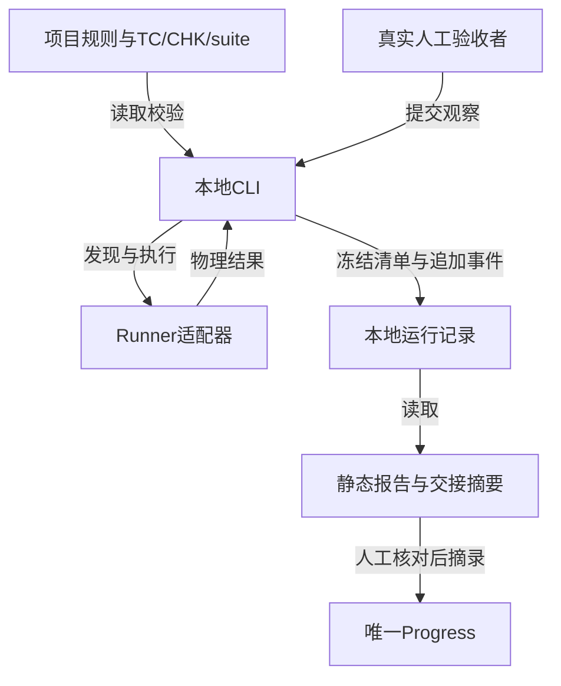
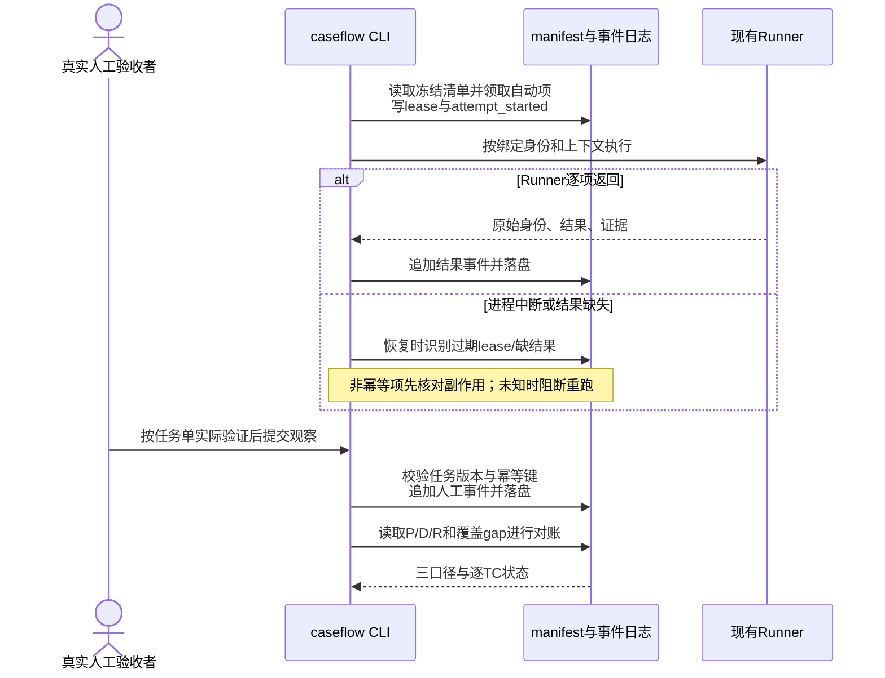

# 用例管理与执行工具研发设计（已被替代）

用户已明确改用一份文字用例文档和执行表；本稿仅保留历史，当前方案见 [简化方案](../design.md)。

本文是供评审及用户审阅的**目标设计**，实际评审结论见 [设计评审](../review.md)，总体阶段只见 [Progress](../Progress.md)。所有 `caseflow` 命令、文件结构和运行结果均未实现。[产品设计 v2](../product.md) 的 RULE-CM-01～18、AC-CM-01～18 是本版输入，尚非用户确认的最终业务契约；[合成场景](../scenarios.md)只验证设计自洽，不是实际测试证据。

| 项目 | 内容 |
| --- | --- |
| 所属迭代 | `2026-10-23-case-management-and-execution` |
| 当前阶段引用 | [唯一 Progress v1](../Progress.md) |
| 文档版本 | v4，2026-10-23，仅排版修订；业务契约沿用已评 v3 |
| 编写人 | `case_tool_design`；评审执行者、对象及实际结论见 [设计评审](../review.md) |
| 相关依据 | [产品 v2](../product.md)（移交指纹 SHA-256 `943aefd21206938bbfb3ec5549d935953bdc2a7f4c6e121c03a8d6283fdd45a1`）、[Dev Flow 总纲 0.32](../../../../skills/dev-flow/references/constitution.md)、[执行协议 0.16](../../../../skills/dev-flow/references/execution-contract.md)、[用例模板](../../../../skills/acceptance-case-design/assets/templates/acceptance-cases.md)、[技术检查模板](../../../../skills/acceptance-execution/assets/templates/technical-checks.md) |
| 项目总架构输入基线 | 本仓库是插件工程，无此工具的现行项目总架构；现有 [schema 1 说明](../../../../skills/dev-flow/references/stage-state.md)与 [核验源码](../../../../skills/dev-flow/scripts/check_iteration.py) 仅作集成边界，不当作新工具现状 |

## 一、本次要完成什么

### 背景与目标

现有 Dev Flow 能规定用例编写、执行证据和阶段核验，却没有长期用例库、固定执行清单、逐项事件及身份对账工具。目标是设计一个单项目本地工具：使维护者能找到当前 TC 及来源，执行者能把全量范围内每个必需检查交代清楚，人工能提交实际观察，协调者能按业务场景阅读有效结论。

### 本次范围

- 新增设计：文件式 TC/CHK 库、suite 与 coverage、运行清单、Runner 适配、事件日志、对账、增量影响、人工队列、静态报告和 Dev Flow 摘要。
- 调整建议：未来接入项目时以结构化资产作为用例/检查权威来源，由它生成或链接人可读视图；旧 Markdown 迁移前仍保持现行权威。
- 范围外：本轮实现、现行 Skill/脚本改动、正式实施计划、在线多用户服务、数据库、完整可写 Web、自动发现所有未知业务规则。

### 完成标准

设计应能逐项推导 AC-CM-01～18，尤其在清单缺入口、Runner 漏结果、同数量不同身份、进程中断、flaky、基线缺失、候选变化和人工迟到提交时给出明确状态与恢复动作。[合成场景](../scenarios.md)覆盖这些条件；正式验证须待未来实际实现。

## 二、当前实现与整体思路

### 当前如何工作

验收用例模板以 Markdown 表格维护业务场景；技术检查模板维护 TC 到多项检查及观察点。执行方法要求固定候选、真实入口、逐项证据与复验。`check_iteration.py` 从 Progress 内**恰一个** `dev-flow-state` schema 1 块读取声明的 `scopes/artifacts/gates/cases`，检查引用、版本、已声明覆盖及证据文件存在；它不调度 Runner、不扫描业务规则寻找遗漏 TC、不证明真实观察。现有 HTTP/UI 夹具可作为未来接入对象，测试名中的 TC 字符串本身不构成检查映射。

### 本次准备如何调整

推荐 `caseflow` 本地 CLI、项目 Git 管理的文件式目录、现有 Runner 适配器、静态 HTML/Markdown 报告和 CLI 人工提交。CLI 读取产品规则引用、TC/CHK、suite 与覆盖声明，先形成不可收缩的 manifest，再发现 Runner 入口并执行、写事件、对账、出报告；人工与自动共享同一 manifest。库文件可选 YAML 供人编辑，内部读取后规范化为 JSON 进行 schema 校验与指纹计算；manifest、事件、报告机器契约使用 JSON/JSONL。YAML 仅接受受限标量/列表/映射，禁止自定义 tag、锚点合并与隐式时间转换，以避免同一内容多种解释。

**目标数据流图**回答本地定义、运行记录与交接摘要如何流转。方框代表本机逻辑模块或文件集合，不代表独立服务；箭头标示所传数据或调用动作。依据为产品 v2 与上述现状；具体目录为建议，未有实现。模块归属及依赖另见第四节文字表，不从此图推断源码依赖。



### 技术反馈与方案比较

| 选择 | 可复用与成本 | 本轮建议 |
| --- | --- | --- |
| YAML 源文件 + JSON 规范形 | 中文编辑及 Git diff 清晰；需严格 schema、稳定序列化及安全解析 | 首选；若项目已有 JSON 权威用例，可直接读 JSON，不强制改写 |
| 全 JSON 源文件 | 解析确定、工具生态简单；手写长步骤与评审 diff 较费力 | 支持导入/导出，项目可按现有习惯选择单一权威格式 |
| Markdown 继续作为唯一机器输入 | 阅读容易；表格难约束稳定预期 ID、组合和版本 | 迁移前维持权威，工具只作候选解析并人工复核 |
| CLI + 静态报告 + CLI 人工提交 | 本地开发、恢复和离线交接简单，复用 Runner；人工需命令入口 | 首期；报告给出可复制的任务 ID 和提交命令 |
| 可写 Web/服务端数据库 | 可改善交互和多人协作；新增身份、并发、部署和双写问题 | 后续有明确需求再设计，不作为首期依赖 |

### 重要取舍

全量的“全”限定为已声明的 suite、规则来源、角色/平台/依赖组合；工具能查出声明范围内漏 TC、漏 CHK、漏 Runner 入口，不能自行证明规则集本身穷尽真实业务。coverage Review 仍由独立测试判断。运行结果为追加事实，当前结论由确定性归并计算，不回写历史事件。增量结果有单独范围标识，不呈现为全量通过。

## 三、核心业务链路

### 链路一：维护库与冻结全量清单

**前置条件：** 产品规则来源、suite 边界及 TC/CHK 已经按 Dev Flow 对应阶段形成；正式 TC 须在完整候选后经独立 Review。

**正常流程：** 维护者校验库，固定 catalog 版本及 Git tree；指定应用候选、环境、fixture、Runner；CLI 生成逐 TC × 必需 CHK × 必要组合的逻辑工作项与物理执行计划绑定，先冻结 manifest，再对实际 Runner 做发现与对账。缺规则映射、待修订必需 TC 与缺执行入口都留在范围账；前两者为 gap，缺入口为工作项诊断。

**失败与恢复：** schema/引用冲突阻止冻结；缺入口不删项，工作项执行状态为 `blocked(reason=entry_missing)`，修改冻结输入后建立关联新 run。

**示例：** suite 声明规则 R1/R2/R3，只有 R1/R2 对应 TC，则 R3 形成 `coverage_gap`，全量清单完整性不成立。

### 链路二：执行、恢复与报告

**前置条件：** manifest 固定且预发现对账完成；每个自动逻辑项有计划绑定的物理执行入口。

**正常流程：** 执行器领取物理执行并写 lease 与 `attempt_started`；Runner 返回后保留物理结果，再按计划绑定逐逻辑项写预期观察和证据判定。运行后在逻辑身份上对账；人工项由真实人按任务单验证并经 CLI 提交。

**失败与恢复：** Runner 退出 0 但缺某结果，该项仍 `result_missing`；进程崩溃后到期 lease 的 attempt 记 `unknown`，非幂等动作先查副作用，未能确认则阻断重跑。

**示例：** 应跑 A/B，实际返回 A/C，即使数量同为二仍报缺 B、额外 C。

**目标时序图**只表达同一冻结 run 的执行、人工等待与恢复顺序，不表示服务端通信。参与者均为本机 CLI/Runner/记录或真实人工；箭头是调用、返回或写入，成功提交以事件落盘为准。依据为产品 v2 RULE-CM-07～10、15～16；具体非幂等副作用检查由项目 adapter 决定，图中不把结果未知画成失败或成功。



### 链路三：增量与修复复验

**前置条件：** 有基线 manifest/库版本、当前候选及有来源的变化说明。

**正常流程：** 变更分析按业务规则、接口/消费者、共享组件、配置/依赖、原缺陷及核心链路关联旧 TC，逐项决策新增、修订、保留、废弃、回归或不选，并给依据；不明影响扩大到相关 suite，仍不明则标未决。旧结果逐项审查有效性，修复产生新候选及关联 run，旧失败保留。

**失败与恢复：** 基线缺失不能生成“零影响”，改全量或保留未决；人工旧候选迟到提交只入旧 run，不推进新候选。具体推演见 [合成场景](../scenarios.md)。

## 四、架构与模块设计

### 项目总架构基线与本轮变化

| 总架构章节/基线 | 当前事实 | 本轮目标变化及理由 | 受影响契约 | 收尾同步 |
| --- | --- | --- | --- | --- |
| 无该工具的项目总架构 | 本仓库只有 Dev Flow 协议、模板、状态核验器 | 新建本地工具目标方案；本轮不生成实际服务架构 | 新库 schema、CLI、Runner adapter、报告；schema 1 不变 | 未来实际实现后再建立有效结构与命令文档 |
| [schema 1](../../../../skills/dev-flow/references/stage-state.md) | 只读检查已声明项 | 人工桥接交接摘要 | `artifacts/gates/cases` 可表达字段 | 后续接入时核对真实文件与候选 |

### 服务端整洁架构分层

不适用：目标是单进程本地 CLI、文件存储及本机 Runner 子进程，没有 HTTP 服务、数据库或服务端 Service。为避免制造层次，以下只定义逻辑模块及依赖；未来若引入服务端，另在实施设计中补分层、Service 时序与 ER。

### 关键架构关系与本轮增量

| 关系类型 | 主体 | 对象 | 具体含义、方向与条件 | 状态 |
| --- | --- | --- | --- | --- |
| 包含 | 本地 `caseflow` 进程 | 校验、规划、执行协调、对账、报告模块 | 同进程逻辑包含；不表示独立部署 | 目标 |
| 源码依赖 | 规划模块 | catalog/suite/coverage 解析契约 | 读取规范化定义；不能从 Runner 名称反推业务预期 | 目标 |
| 源码依赖 | 执行协调模块 | Runner adapter 接口 | 通过显式绑定发现和启动；adapter 返回原始测试身份及观察 | 目标 |
| 端口实现 | 各 Runner adapter | `discover/execute/normalize` 契约 | adapter 为外层实现；未来具体 Runner 由项目选择 | 目标，未定实现 |
| 装配 | CLI 配置加载 | 执行协调模块的 adapter 参数 | 按项目显式配置选择实现，拒绝未注册 Runner；不做全局自动猜测 | 目标 |
| 文件读写 | CLI | catalog 与 run 目录 | catalog 只读；单写锁下原子写 manifest，JSONL 追加事件 | 目标 |

### 模块分工

| 模块 | 职责 | 输入与输出 |
| --- | --- | --- |
| Catalog 校验 | schema、唯一 ID、引用、生命周期、指纹 | TC/CHK/suite/coverage → 规范形与诊断 |
| Planner | 全量/增量选择、组合展开、缺口保留、manifest 冻结 | 规范形+候选/环境 → manifest |
| Runner adapter | 项目 Runner 发现、执行、结果身份与证据归一 | binding 与 context → discovered/results |
| Coordinator | 单写锁、lease、attempt、人工事件、恢复 | manifest + 事件 → 追加日志 |
| Reconciler | 集合对账、证据有效性、TC 与三口径结论 | manifest/discovery/results → 诊断及摘要 |
| Reporter | 业务视图及可交接摘要 | 只读运行记录 → 静态 HTML/Markdown/JSON |

### Service / Usecase 业务操作清单

服务端操作不适用。CLI 操作见本节命令契约；本地各模块的详细规则在第五节，第三节已给三条核心链路。没有服务端持久化事务，不能把文件锁称为数据库事务。

### 接口与数据契约

**权威与目录。**建议项目中 `docs/dev-flow/cases/catalog.yaml`、`suites.yaml`、`coverage.yaml` 或等价 JSON 组成唯一当前定义；业务规则仍在产品权威文档中。catalog 以语义版本 `catalog_version`、Git tree/内容指纹、schema 版本标识；每个 TC/CHK 有稳定 ID、单调 `revision` 和规范内容 SHA-256 指纹。版本是审阅标签，指纹用于检测实际字节/规范形变化；两者不一致时拒绝复用。历史由 Git 保存，废弃 ID 永不重用。运行记录建议 `.dev/caseflow/runs/<run-id>/`，跨机器正式摘要另存项目文档，私有原始日志不作为唯一交接材料。

| 对象 | 必需字段与关系 | 不变量 |
| --- | --- | --- |
| `TC` | `id,revision,title,scope,source_rules[{id,version}],lifecycle(active/pending_revision/retired),preconditions,steps[],expectations[{id,text}],owner,change_source` | 用户语言预期独立于技术检查；预期 ID 稳定，变更升 revision；废弃写原因与替代 ID；待修订仍进入缺口账 |
| `CHK` | `id,revision,tc_id,expectation_ids[],method(auto/manual),observations[],evidence_kinds[],binding?,contexts[],required` | 每个必需预期至少有一项必需 CHK 覆盖；一个 CHK 可覆盖多预期，但结果逐预期映射；仅列名称不算观察 |
| `suite/coverage` | suite ID、已登记有效 RULE/AC 集合与版本、适用 TC/角色/平台/依赖范围、排除与依据、核心链路；coverage 为 RULE/AC → TC → expectation → 必需 CHK 显式边 | 每个有效 RULE/AC 无 TC、每个 TC 预期无必需 CHK 均生成稳定 gap；源自身遗漏只能经产品/验收 Review 发现 |
| `candidate/context` | commit、工作树 dirty 标志与包含 staged/unstaged/untracked 的差异清单或内容指纹；artifact/build ID；测试脚本/执行绑定指纹；环境配置及敏感值的非明文指纹、fixture 版本/种子、Runner 版本与 adapter 指纹 | 指纹覆盖影响结果的有效输入；含不受 Git 管理的构建物须给实际标识；秘密不写入报告 |
| `manifest` | `run_id,mode,scope,catalog snapshot/hash,candidate/context,selection reasons,items[],executions[],gaps[]` | 生成后只读；每项身份含 TC revision、expectation ID、CHK revision、context/组合 key；`executions[]` 固定 `execution_id,runner_id,context_fingerprint,item_ids[]` |
| `event` | `event_id,idempotency_key,run_id,item_id,attempt_id,type,actor,actor_kind,time,payload_hash,prior_event?` | 仅追加；相同 key 同 payload 返回原事件，不同 payload 冲突；更正用新事件关联原事件 |

一个 manifest **逻辑工作项**是 TC × CHK × 必要组合，包含该 CHK 覆盖的预期 ID 集合。**物理 execution** 是一次 Runner 调用，保留自身 `execution_id/runner_id/context` 与原始结果。规划时写定 `execution_id → item_ids[]`，默认严格 1:1；仅在 adapter 显式声明共享安全，且 binding、候选、环境、fixture、身份/权限、隔离数据、观察点及组合上下文完全一致时允许 1:N。组合只展开声明所需值，不做无依据笛卡尔积。共享时两条逻辑 item 各自保存逐预期观察、证据类型和适用性判定；物理一次通过不能补齐某条 item 缺的观察。未声明安全、多物理结果争用同一 item、同一 `runner_id` 在不同上下文被误合并均是绑定冲突并阻断，不以“共享”消除重复。映射不存在或不充分保留 `mapping_gap`。

以下是**字段关系示意**，不是已生效 schema 或真实记录。`item_id` 由稳定 ID、revision、组合及冻结上下文规范化计算，展示字符串只是可读别名；实现应同时保存完整 identity 对象并对其做哈希，避免分隔符碰撞。

```yaml
tc:
  id: TC-01
  revision: 2
  source_rules: [{id: RULE-X-01, version: 1}]
  expectations: [{id: E2, text: 刷新后偏好仍相同}]
chk:
  id: CHK-UI
  revision: 2
  tc_id: TC-01
  expectation_ids: [E2]
  method: auto
  observations: [refresh-persist]
  binding: ui.preference.refresh
```

```json
{
  "run_id": "R42",
  "manifest_hash": "sha256:...",
  "candidate": {
    "commit": "abc", "dirty": true, "dirty_fingerprint": "sha256:d1",
    "test_scripts_fingerprint": "sha256:t1", "bindings_fingerprint": "sha256:b1"
  },
  "context": {
    "environment": "ENV-1", "fixture": "F1", "runner": "A1",
    "adapter_fingerprint": "sha256:a1"
  },
  "item": {
    "item_id": "TC-01@2/CHK-UI@2/user-web",
    "identity": {
      "tc_id": "TC-01", "tc_revision": 2, "expectation_ids": ["E2"],
      "chk_id": "CHK-UI", "chk_revision": 2,
      "combination": {"role": "user", "platform": "web"},
      "context_fingerprint": "sha256:c1"
    },
    "required": true
  },
  "execution": {
    "execution_id": "EX-1", "runner_id": "ui.preference.refresh",
    "context_fingerprint": "sha256:c1",
    "item_ids": ["TC-01@2/CHK-UI@2/user-web"]
  }
}
```

同一 run 的人工项是 `TC-03@1/CHK-MANUAL@1/user-device`，映射 `TC-03/E1` 的 `feedback-visible` 观察，没有 Runner execution。对应提交事件只示意关键字段：

```json
{
  "event_id": "ev-7", "idempotency_key": "uuid-7", "run_id": "R42",
  "item_id": "TC-03@1/CHK-MANUAL@1/user-device",
  "type": "manual_observation", "outcome": "fail",
  "tested_by": "甲", "recorded_by": "AI", "actor_kind": "ai_transcription",
  "verified_at": "2026-10-23T10:00:00+08:00",
  "recorded_at": "2026-10-23T10:05:00+08:00",
  "feedback_source": "甲在本轮对话说：目标设备未显示反馈提示",
  "observations": {"feedback-visible": "未显示"},
  "candidate_fingerprint": "sha256:candidate1", "payload_hash": "sha256:..."
}
```

代录反馈必须可判断实际观察；此示例结果为失败，不凭 AI 录入改绿。

**集合对账。**全量范围账 `L` 先枚举已登记有效 RULE/AC、TC 与逐项预期；无法展开为执行项的规则无 TC、预期无必需 CHK 仍在 `L` 生成稳定 gap。`P` 是冻结的必需**逻辑 item**身份集合。adapter 先保留原始物理发现 `D_phys={runner_id,context}` 和原始物理结果 `R_phys={execution_id,runner_id,context,raw}`，再按 manifest 固定的 `execution_id/runner_id/context → item_ids[]` 投影为逻辑 `D`、`R`。默认 1:1；合法 1:N 时投影出每个 item，但逐 item 观察与证据仍分别判定。预执行计算 `P_auto-D`（缺入口）、范围内错误身份/重复绑定/越权共享；运行后计算 `P_auto-R`（未运行/结果缺失/未知）、范围内 `R-P_auto` 和逐预期观察差异。已声明可选或范围外的物理发现/结果单列附加账，不计入必需 `P`、不冒充覆盖，也不因整 suite 的合法额外项单独阻断；**范围内本应映射却未映射或映射到错误身份**仍阻断。身份包含 revision/context，不能以数量或测试名字符串代替；物理事实不因投影而丢失。人工项在 `P` 中，通过任务单登记入口，不加入 Runner `D`。`L` 的覆盖/映射 gap、待修订项及 `P` 的缺入口诊断均在报告中。`entry_missing` 是诊断原因，不是执行状态；该必需项状态为 `blocked(reason=entry_missing)`，覆盖 gap 则是范围账诊断，不强造没有 TC/CHK 的 item。

冻结 manifest 绑定候选源码及 dirty 内容、测试脚本、执行绑定、adapter/Runner 和环境/fixture 指纹。仅当这些输入全部未变、只是临时发现故障恢复时，才允许在同一 run 重新 discover 并保留历次发现记录；补测试脚本、修改 binding/CHK 或 Runner/adapter 版本会改变冻结输入，必须建立关联的新 run。不能通过重新 discover 暗中改写旧 manifest。

**口径与状态。**工作项保存当时的执行事实（`pending/running/pass/fail/blocked/skipped/unknown/result_missing`）、对当前候选的证据适用性（`valid/stale/unknown/evidence_missing`）及另行计算的验收判断，三者不互相覆写。`flaky_pending` 是先失败后通过的验收待处理标记。已记录 `skipped` 不等于允许豁免；豁免须改变 suite/业务范围并经适用 Review、新 run。三口径分别为：①**清单完整性**：已登记有效 RULE/AC 与 TC/预期/必需 CHK/入口映射无未决 gap 且发现身份对账成立；②**执行完成**：本 run 每个必需 item 有可判定的有效执行结果，`unknown/result_missing/pending/running/blocked/skipped` 均不完成；同候选失败后通过是执行已结束，证据缺失/失效使当前有效执行结论不足；③**验收结论**：清单完整、当前证据适用、执行完成、全部必需项有效通过且无 `flaky_pending`，独立 Review 与交付门槛仍按 Dev Flow 成立。失败虽终结但验收失败；先失败后通过验收未完成。解除 `flaky_pending` 必须有根因处理：产品缺陷修复后的**新候选复验**，或有依据纠正测试/环境误判并在相应 **CHK/环境新版本的新 run** 检查；旧失败及关联保留。仅追加重试、人工一键绿或减少断言均无效。报告对全量/增量分别标注，不把增量三口径推及全项目。

| 对象 | 清单完整性 | 执行完成 | 验收判断 |
| --- | --- | --- | --- |
| 单 item | 必需身份、绑定与预期映射成立 | `pass/fail` 且必要证据有效；`blocked/unknown/skipped/缺结果` 不完成 | 有效 pass 且无 flaky 才通过；fail 为失败，其他为未完成 |
| TC | 每项预期均有必需 CHK 且映射无 gap | 所属全部必需 item 执行完成 | 任一失败显示失败；同时保留其他待验/受阻原因；无失败但有待验为未完成 |
| run/声明 suite | RULE/AC→TC→预期→CHK 与发现集合完整 | 全部必需 TC 执行完成 | 任一失败显示失败并列全部未完成原因；无失败但有 gap/待验为未完成；全满足才通过 |

多项混合时单一首页标签以“失败”优先于“未完成”，但逐项清单、数量和原因并列显示，不把失败标签当作待验事项已解决。

### 数据模型关系与 ER 图

无数据库与实体外键，ER 不适用。文件关系由上表及 manifest 引用定义：一个 catalog 含多 TC；TC 含多预期并关联多 CHK；一个 run 固定一个 catalog/context 快照并含多 item；item 有多 attempt/人工事件。ID 是文件内逻辑引用，完整性由校验器检查。日志与 manifest 分开：manifest 不变，日志追加；报告为可再生视图。未来若引入关系存储须重新定义迁移与一致性。

### 必须保持的约束

项目库写入通过 Git 审阅；运行目录采用同一 run 单写锁与原子临时文件替换，事件写入 flush/fsync 后才对提交方返回成功；锁 owner、进程及过期信息可诊断，过期锁经进程/主机判别与人工或安全抢占规则恢复，不能直接覆盖活锁。worker lease 是工作项领取权而非结果事实，带 token/期限；旧 lease 的迟到结果只入冲突/隔离队列，不覆写新 attempt。并行仅允许不同隔离 fixture/资源；非幂等动作结果未知时查副作用或人工判定后再重跑。原始证据路径做内容摘要，防目录穿越与秘密泄露；报告只引用允许交接的摘要或脱敏附件。

## 五、具体实现设计

### 库校验、规划与增量

**实现逻辑：** 校验规则源和映射、revision/指纹及生命周期；全量从 suite 规则集合反查 TC/预期/CHK，缺口形成稳定 gap ID。增量比较基线与当前的规则、TC/CHK、binding、候选/配置、依赖/消费者和缺陷，形成 `change → impacted → selected/excluded/unknown` 表；新增、修订、废弃、保留、回归逐项有来源及理由。缺基线退回全量建议；共享依赖影响未知时安全扩大相关 suite 或保留未决，不允许空集自动通过。旧证据按 item 的业务预期、检查、候选差异影响、环境、fixture、Runner、证据可取得性逐项判断；复用事件记 `from_run/from_item/reason/record`，报告标旧候选来源与限制。候选变化默认旧结果失效，只有具体影响依据成立才复用；新候选仍需必要整体集成检查。

**主要改动（未来建议位置，未创建源码）：** `caseflow/catalog/*` 管 schema，`caseflow/plan/*` 管范围与差异，`caseflow/run/*` 管事件/lease，`caseflow/adapters/*` 管 Runner，`caseflow/report/*` 管视图。首期依赖 Python 标准库加安全 YAML 解析库（具体版本待实施选型）；无需服务端依赖。

**边界情况：** `retired` 保留历史但不成为当前执行项；废弃理由/替代未评审形成 gap；`pending_revision` 必需项不能静默剔除。旧结果复用只影响运行 item 的证据来源，不减少计划集合。

### Runner、人工与报告

**Runner 接口：** `plan_bindings(items,adapter_declaration,context) → [{execution_id,runner_id,context,item_ids[],share_safety_basis}]` 在 manifest 冻结前形成计划绑定，默认一个 item；`discover(context,binding) → [{runner_id,context,evidence_capability}]` 在冻结后独立验证实际物理入口；`execute(execution_ids,context,lease_token) → physical_result_stream`；`normalize(raw,binding) → {execution_id,runner_id,raw_evidence_refs,item_results:[{item_id,expectation_results,observations,evidence_refs,outcome}]}`。adapter 必须保留原始 Runner ID、退出码、标准输出/报告摘要、未映射结果；每个 `item_results` 必须核对 manifest 所需预期与证据，漏一个即该 item `result_missing/evidence_missing`，不能用同次物理成功或别的 item 观察补齐。Runner 退出码 0 不是逐项完成。Runner 不能按选中项执行时可按 suite 执行，但额外物理发现/结果仍报告且不能混进必需集合。真实/模拟边界由 context 与 evidence kind 共同表达。

**人工接口：** 队列按业务场景显示入口 URL/路径或设备操作、身份类别（如管理员/普通用户，不存凭据）、fixture/准备责任、步骤、逐预期观察和证据要求。CLI 提交 `outcome=pass/fail/unable_to_verify`，带任务 token、幂等键、`tested_by/recorded_by`、`verified_at/recorded_at` 和反馈来源。`pass/fail` 要有逐预期实际观察及必要证据。`unable_to_verify` 是已记录但未完成的人工 attempt，须写 `reason`、准备责任方、`recorded_at` 和可得的阻断线索；因未实际验证不填 `verified_at`，归并为 `blocked`，TC 与整体保持未完成。设备恢复且冻结输入未变，可在同 run 用新 attempt 验证，旧 blocked 事件保留；设备/fixture/候选等输入变更则新 run。自录时 `actor_kind=human`，AI 代录标 `actor_kind=ai_transcription`，原始反馈须可判断实际观察，“应该好了”保持待验；`actor_kind=ai_operation` 单列。单机身份仅为声明与追溯。token 绑定 run/item/candidate/revision/context；迟到旧提交只属旧 run，相同 key/相同 payload 返回原事件，不同 payload 冲突并要求更正事件或新 attempt，不靠覆盖改绿。失败关联原缺陷入口、修复候选及复验 run。

**报告：** 首期静态 HTML/Markdown **只读，不提交或写回**；首页按业务 TC 展示场景、规则来源、逐预期实际/证据、必需项状态、人工待办、缺口和三口径，人工提交通过 CLI 完成。技术区显示物理 `execution_id/runner_id` 与逻辑 item 投影、attempt、版本及未映射结果。正式摘要逐 item 记录证据 kind、内容 SHA-256、可访问归档引用与可复核状态 `available/private_missing/redacted`，并记录 run/candidate/catalog/context/manifest 指纹、L/P/D/R 与三口径。`redacted` 仅当脱敏材料仍足以证明必需观察才可用于通过；`private_missing` 或仅存哈希/摘要而必要原始观察不可得则 `evidence_missing`。原始日志可留 `.dev/`，哈希不能顶替原始观察；保存期限由试点项目运维/验收决定，本文不假定已有归档能力。

### 拟议 CLI 契约与例子

以下命令和 JSON 均是未来接口示意，**当前仓库不可运行**；具体拼写与 schema 在实施设计后固定。

```sh
caseflow catalog check --project . --suite core --json
caseflow plan full --suite core --candidate '<commit+dirty-fingerprint>' --context local-real --output .dev/caseflow/runs/R42
caseflow plan incremental --suite core --baseline R41 --change changes.yaml --candidate '<new-fingerprint>'
caseflow run R42 --jobs 2
caseflow resume R42
caseflow manual list R42
caseflow manual submit R42 --item 'TC-03@1/CHK-MANUAL@1/user-device' --token '<task-token>' --outcome fail --observation observations.json --actor '<实际验证者>' --key '<提交UUID>'
caseflow manual submit R42 --item 'TC-03@1/CHK-MANUAL@1/user-device' --token '<task-token>' --outcome unable_to_verify --reason '设备不可用' --owner '<准备责任方>' --key '<另一提交UUID>'
caseflow reconcile R42 --json
caseflow report R42 --format html --output .dev/caseflow/runs/R42/report.html
caseflow export dev-flow R42 --output .dev/caseflow/runs/R42/dev-flow-summary.json
```

`catalog check` 输出错误、待决和覆盖 gap；`plan` 输出 `run_id/manifest_hash/planned_items/gaps/discovery_mismatch`；`run/resume` 输出 attempt 统计与未完成项；`reconcile` 输出 `planned/discovered/results` 身份差集、三个独立口径及逐 TC 状态；`manual submit` 输出事件 ID 与是否幂等重放；`export` 只生成待人工核对摘要，不写 Progress。退出码建议：`0` 命令自身成功且该命令所要求的口径成立；`1` 有明确未完成/失败/对账差异；`2` 输入或 schema 错误；`3` 锁/外部 Runner/持久化故障且结果可能未知。`run` 的 Runner 返回 0 仍可能返回 1。所有 JSON 输出包含 `schema_version, run_id, manifest_hash, candidate_fingerprint, generated_at`，错误给出对象 ID 与恢复建议。

### 配置、依赖与数据变更

首期本机文件及 Runner 环境需由项目明确配置：catalog 路径、suite、adapter 名/版本、可执行文件、fixture 隔离、允许的证据目录与脱敏策略。建议配置中的秘密仅以环境引用表示，manifest 记录引用名及非明文指纹；运行环境实际可用性由运维/执行者核验。没有现有数据迁移可直接执行；旧 Markdown 转换须先解析为候选 catalog，逐 RULE/AC、TC、预期、CHK 与历史 ID 人工 Review，形成差异和回滚入口，Review 后才切换权威并停止旧源写入，绝不长期双写。

## 六、兼容、风险与待决事项

### 兼容与恢复

首期只读现有 Runner 入口，通过 adapter 映射，不要求重写测试；无稳定可发现 ID 的 Runner 必须提供显式绑定文件并人工复核。运行目录损坏时从已 fsync 的 manifest/event 重建索引和报告，截断的末尾事件隔离并标未知。跨机迁移需携带 manifest、正式摘要和可交接证据；缺原始私有证据的观察不能假定仍有效。现行 Dev Flow schema 1 不变，未来工具与 Progress 之间是人工核对桥接。

### 尚未解决的问题

| 问题/性质 | 影响 | 后续解决方与方法 |
| --- | --- | --- |
| 项目 Runner 类型及发现稳定性未知 | adapter 具体实现与共享检查安全性 | 研发在首个试点项目调查真实 Runner API；架构 Review 绑定与隔离约束 |
| YAML 与 JSON 项目选择是候选 | 影响迁移与编辑体验 | 试点项目维护者确定单一权威格式；结构语义保持一致 |
| 真实身份验证机制未定 | CLI 人工声明可追溯但无法阻止冒名 | 首期由项目入口/记录流程核对；若需强认证再设计服务或签名 |
| 规则来源本身可能不完整 | 全量只能覆盖声明范围 | 产品与独立验收 Review 检查原始规则/交付任务，不由工具自动宣称穷尽 |
| 私有日志跨机保留策略未定 | 证据可复核期限 | 试点项目运维/验收确定归档与脱敏；缺失时保持证据不足 |

## 七、验证与交付方式

### 关键验证

| 要验证的结果 | 未来实现后的验证方式 | 通过标准 |
| --- | --- | --- |
| 清单范围与身份对账，AC-CM-03/05/08 | 注入缺 TC、缺入口、A/B 对 A/C 和 Runner 0 漏结果 | 逐身份缺/额外显式，数量相等不放行 |
| 事件恢复，AC-CM-07/10 | 进程在非幂等动作后中断、重试先失败后通过 | 未知先查副作用，历史失败和 flaky 不消失 |
| 增量与复用，AC-CM-12～14 | 缺基线、共享契约、配置变化、候选修复 | 安全扩大或未决，旧证据逐项失效/复用有依据 |
| 人工与复验，AC-CM-15～17 | 迟到/重复/冲突提交及修复候选 | 真人与代录可分，旧提交不推进新候选 |
| Dev Flow 桥接，AC-CM-18 | 用真实 run 摘要人工映射 schema 1 并运行现有核验器 | 只使用既有可表达字段，核验器通过不声称语义覆盖 |

本轮只完成文档自查与 [合成推演](../scenarios.md)，以上未来验证未执行。正式用例遵循完整候选后维护及独立 Review；研发局部测试、验收独立执行、运维实际交付分别记录。

### 交付方式与 Dev Flow 桥接

未来工具交付形态建议为本地 CLI 包、项目配置及 Runner adapter、静态报告；本轮交付仅本文与示例。`export dev-flow` 生成逐 TC/CHK/观察/证据映射及差集，主 Agent 与验收者核对后，在唯一 Progress 的现有 schema 1 块中**手工**引用实际 `artifacts`、每个正式 TC 的 `cases.required_checks` 和对应 `gates`。此外本轮 scope 的 `before_finish` **必须**引用一个范围对账 `kind: check` gate，不能因 `L` 的 gap 没有 TC/CHK 而省略。其 `inputs` 绑定冻结 manifest 与正式摘要的实际 artifact 版本，`required_coverage` 明列 suite、已登记 RULE/AC、组合范围及 gap 清零/身份对账要求，`record` 指向载有 `L/P/D/R`、manifest hash、候选指纹和差集的正式摘要。未决 gap、范围内身份差异、必要证据不可得时此 gate 保持 `pending/blocked/failed`，不得 passed。全量与增量分别设置范围标识；增量 gate 只能断言选定增量范围，不替代项目全量结论。此方案使用 schema 1 既有字段表达，仍需人工核对 `required_coverage` 是否真实完整。

逐 TC check gate 使用 schema 1 现有 `status`、`inputs`、`required_coverage/coverage`、`expects/evidence`、`candidate`、`record/completed_at`，必要复用用现有 `reuse`。保守状态映射如下；不存在与新工具完全等价的 schema 1 状态时选择不放行值，并在原记录保留精确原因。

| caseflow item/判断 | schema 1 gate 状态 | 记录要求 |
| --- | --- | --- |
| `pending/running/unknown/result_missing/skipped` | `pending`；未知且有明确资源障碍可 `blocked` | 不填完成时间或通过证据；原记录保留阶段与原因 |
| `blocked`，含 `entry_missing/unable_to_verify` | `blocked` | 保留缺入口/准备责任与恢复路径 |
| `fail` | `failed` | 保留实际失败与关联缺陷 |
| `pass` 但 `flaky_pending`、证据 `stale/private_missing` 或必要观察不足 | `pending`，明确可判定失败时 `failed` | 不因 Runner 0 或摘要 hash 标 passed |
| `pass` 且逐预期必要观察/证据有效、无未决风险 | `passed` | `record` 和 `evidence` 引用实际可复核原记录，输入/候选一致 |

人工检查仍是 check gate，`record` 指向正式人工记录，实际执行者在原记录中，不能仅靠 schema 1 gate 推断人工真实性。范围对账摘要可作为 **`kind: artifact` 的对账观察**（例如 `manifest-identity-reconciled`）的证据，前提是摘要自身可访问、输入/候选匹配且内容经人工核对；它不能替代 UI/API/设备等逐 TC 原始观察。原始必要材料缺失时相应 TC gate 不得通过，即使范围摘要 hash 存在。`before_finish` 的其他独立 Review/交付门槛仍由主 Agent 按实际范围维护。现行 `check_iteration.py` 仅验证**已声明**状态一致性，不读新工具产物、不自动补 gate、不证明真实覆盖；未来若要自动桥接或扩展字段，另行设计版本升级与兼容迁移。

## 八、引用与关联文档

| 文档 | 维护者 | 本轮状态与作用 |
| --- | --- | --- |
| [Progress](../Progress.md) | 主 Agent | 流程 v1 已确认，唯一总体进度；本设计不修改 |
| [产品设计](../product.md) | 产品/主 Agent | v2 候选，RULE/AC 输入；重要业务取舍尚待审阅 |
| [合成场景](../scenarios.md) | 研发 | v4 设计推演，不是执行证据 |
| [设计评审](../review.md) | 独立架构与验收评审者、主 Agent 记录 | 实际对象、发现、修订和定向复核结果的权威入口 |
| 实施计划/架构技术收尾/正式用例 | 相应职责 | 本轮不形成；待未来实施授权与完整候选 |

现行协议与源码入口见文首及第四节。两张 Mermaid 图分别表达本地数据流和执行/人工等待的时序；模块关系由表格独立说明，核心链路正文保留失败恢复细节。没有服务端部署、数据库关系或已有可引用工具总架构，因此裁剪服务端分层与 ER。v3 将数据流改为纵向、链路分段且 JSON 多行展示；图示实际渲染与一致性核验结果见 [设计评审](../review.md)。
