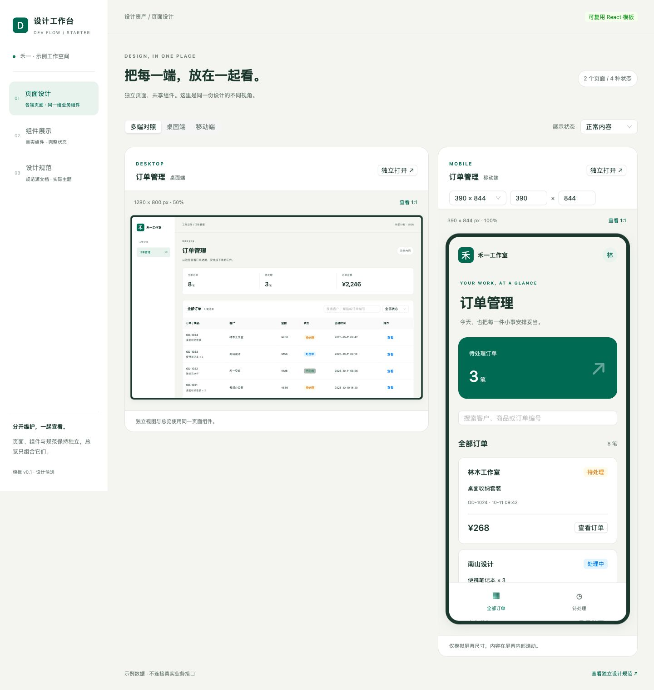
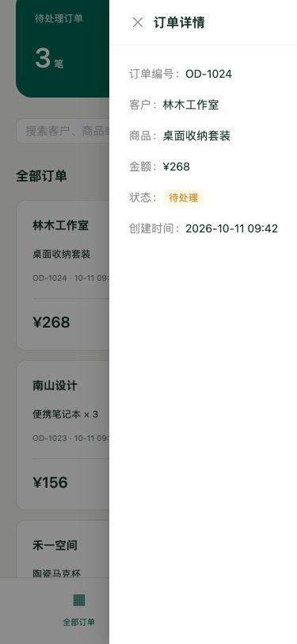

# React 设计稿模板 v0.1 验证

日期：2026-10-12。主 Agent 顺序实现与自查，未派发独立职责 Agent。基线提交 `42f0089`，分支 `codex/modular-ui-design`，成果为未提交候选；模板源码逐文件 SHA-256 见 [source-fingerprints.json](source-fingerprints.json)。此记录证明隔离工具与示例页面范围，不登记真实项目采用或生产交付。

## 产出和运行范围

权威模板位于 `skills/dev-visual/assets/design-workspace/`，复制工具为 `skills/dev-visual/scripts/design-template.mjs`。模板 29 个文件含独立规范、页面/组件契约与锁文件；工程复制到仓库忽略的 `.dev/react-design-template/project/design/prototype/`，没有引用插件运行目录或全局链接。运行副本与最终模板逐文件一致；副本来源清单保留初次复制时的哈希，之后的修正作为项目副本修改，不用初始化覆盖。

环境：macOS，Node.js v24.21.0，npm 11.19.0；React 19.3.0、antd 6.6.5、TypeScript 7.0.2、Vite 8.3.3。执行 `npm ci --no-audit --no-fund`，由锁文件安装。开发服务实际地址 `http://127.0.0.1:50115/`；临时构建预览为 `http://127.0.0.1:50927/`，检查后停止。地址仅表示本次本机进程，重启需读取新输出。

## 检查结果

| 检查 | 实际结果 |
| --- | --- |
| 初始化与保护 | Node 5 项测试通过：完整副本/锁文件/来源哈希、重复初始化保留定制、非空目标不部分覆盖、项目外/符号链接路径拒绝、空目录及中文空格路径支持；不复制依赖与运行产物 |
| 独立安装与构建 | 副本锁文件安装、严格类型检查和 `npm run build` 通过；生产 JS 约 1.16 MB、gzip 368 KB，Vite 报大块提示，当前未做性能预算验收 |
| 总览与各端入口 | 外部 1440×1080 检查两端对照及单移动端展示；总览 iframe 与独立路由从同一注册表取实际组件，没有平行页面实现 |
| 状态与实例边界 | 两端正常 8 笔、加载骨架、空内容与失败均可复现；空场景摘要均为零。移动搜索林木仅 1 个卡片，桌面仍为 8 条；移动待处理筛选为 3 个卡片。移动恢复后桌面仍显示失败，各自可恢复 |
| 详情与反馈 | 桌面独立页搜索后显示 1 条订单并打开对应详情；移动页可从长列表最后订单打开详情；组件展示引用实际 OrderSummary 的有/零内容两个实例、三种标签和禁用/处理中按钮，主要操作显示成功反馈 |
| 内部屏幕尺寸 | DOM 实测 iframe 文档视口：桌面 1280×800；移动 390×844、375×812、430×932 与自定义 412×915，移动 scrollWidth 等于指定宽度。外层缩放标注比例，桌面对照为 50% 时内部仍为 1280×800 |
| 滚动与弹层边界 | 移动长列表 scrollHeight 2183，PageDown 后内部 scrollTop 大于零；固定分类位于内部视口底部，详情和遮罩留在对应 iframe；375×812 独立静态页无横向溢出 |
| 独立规范与主题 | 规范读取 Markdown 原文，规范展示从实际主题生成 10 个语义颜色及字号/间距；追加测试标题后界面热更新，随后恢复原文。组件契约的相对规范链接映射到规范展示入口 |
| 静态产物路由 | 构建预览的两端独立页、组件、规范及总览均可访问；规范 hash 入口刷新后仍可用，总览加载 1280×800 与 390×844 的页面 iframe |
| 宿主入口与打包 | `sync_host_agents.py --check` 通过；新增文件纳入 Git 清单，`manage_plugin.py install/check` 通过，8 个 Skills 启用且 `source_matches_cache=true`。从安装缓存实际初始化另一个空项目，29 个文件哈希与模板一致，不复制依赖 |

检查中修复移动空场景仍显示待处理数量的问题，以及 Markdown 相对文件链接在应用中指向错误地址的问题；修复后复查空状态、规范链接/热更新及构建。浏览器自动化改用控件的可见标签点击 antd 虚拟选项和分段标签，不将自动化定位失败登记为页面失败。

## 渲染证据

总览：外部 1440×1080 的完整页面截图，内部桌面 1280×800、移动 390×844。

独立移动静态页面：375×812，详情与遮罩保持在屏幕边界内。

## 未覆盖范围

示例是本地虚构订单任务，未连接真实 API；用户尚未确认示例品牌或风格为正式基线。未验证真实移动浏览器、原生平台、软键盘/触摸/设备 API、远程部署、项目 shadcn 接入、生产性能或独立职责行为。后续项目持续维护副本及现行规范，迭代只关联版本和增量；实际接入后重新检查受影响消费者。
