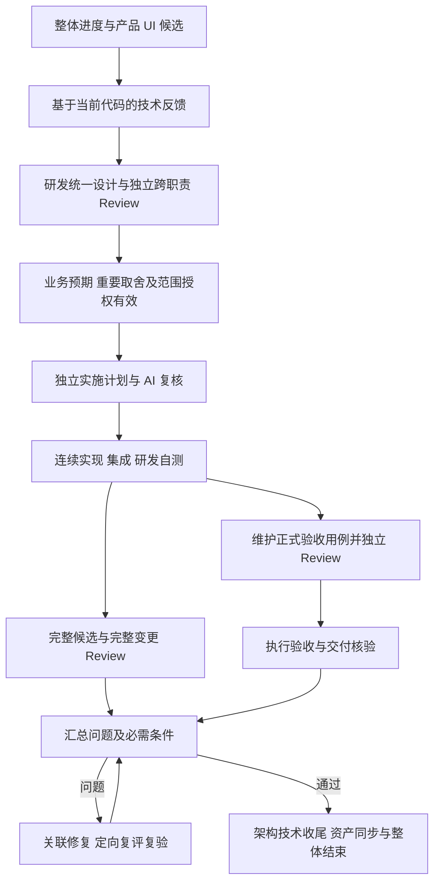

# 设计确认、计划复核与自主实现

日期：2026-10-21。完整功能采用设计期跨职责 Review、统一研发设计、计划复核、连续实现及实现后的正式验收。具体路径见[任务路由](task-routing.md)，用户当前要求与宿主约束优先。有效设计、确认和已完成检查按实际覆盖复用，不重走全套审批；无 UI 的任务不制造 UI 成果。

## 按当前状态推进

先恢复用户最终目标、完整交付范围、路径依据、当前阶段、输入/候选版本、有效决定、实际 Review、检查与未完成项。循环为：`恢复有效状态 → 核对当前依赖 → 实际工作 → 更新权威进度及引用 → 继续下一步`。阶段完成和整体完成分别判断，不能把本次会话完成的方案、派发或局部检查当成整体终点。

按[进度管理](progress-management.md)选择实际可用的 Harness Todo 或持久 Progress/既有索引。开始列出通向最终交付的全部大阶段，包括尚未开始的实现、验收、交付和收尾；每阶段有目标、依赖、执行者、完成条件与成果入口。派发、回报、确认、阶段/基线/候选变化和结束前，更新当前目标、动作、下一步、阻塞与遗留。

多阶段、持续实施或跨会话任务必须保留可恢复的完整进度；需要对候选、版本和证据依赖做机器核验时，按[结构化状态](stage-state.md)在选定的唯一权威位置维护一个状态块；索引、设计、计划和 Todo 引用或投影该状态，不手填第二套总体阶段。进入受影响实现、基线变化后及结束前运行相应核验。工具仅检查已声明记录，不证明真实执行、语义覆盖或设计质量，不提供操作拦截；主 Agent 对依赖是否完整和完成结论负责。

混合任务逐范围判断：纯文案与新增交互分别裁剪，只继续依赖独立且已授权的工作。不能用拆分范围规避完整候选集成，也不能因为工作可逆就跳过未确定的行为设计。

### 每次实际 Review 的最小记录

记录对象/输入版本、执行者与实际方式、检查依据与范围、具体发现（允许零发现）、处理、定向复核及通过/阻断结论、执行时间和原记录。标准跨职责任务默认使用独立专业上下文；作者自查不能冒充独立 Review。无法委派时如实记录降级；用户明确要求独立评审时保留待评审，不用自查替代通过。

设计期技术反馈、研发设计、计划和完整实现的正式 Review 默认在独立 `engineering/review.md` 中分对象、版本维护；对象复杂时按需拆分。正式验收用例的覆盖 Review 在验收资料中维护，由研发 Review/主设计引用。原始日志和逐次重试留在本机目录，持久文档保存重要发现、结论和未关闭项。同一文件指定一个整合写入者，各评审者对自己的实际结论负责。

依赖尚未有效时的草稿或提前自查不能替代正式复核。设计、计划、用例或候选变化时只重审受影响部分，未受影响结论有明确依据时复用。

## 首次实施的人工同意

首次进入本次正式实现范围前，展示具体范围、路径依据、可观察结果、验证与交付，取得用户明确实施同意。已有同一范围授权持续有效，跨会话、内部切片和授权内修复直接复用，不因记录格式重复询问。用户明确要求按已展示计划开始或继续时记录并执行；需求表达、局部布局答复、查看文档、未答复和预选选项不自动成为开工同意。

标准任务可在设计确认中明确合并为“计划 AI 复核通过后按此范围开始”。同一次答复分别记录业务预期/重要取舍确认与实施授权；研发设计和实施计划由 AI Review，不新增人工计划审批。正式完整 TC 不再是实施前置，不能等待一轮提前的 TC 人工确认。

等待依赖性决定时继续研究、受控可行性实验、验证准备和独立已授权工作。改变范围、重要业务/契约或交付边界时只请求受影响决定与必要授权，无关范围继续。基线确认不会扩大推送、合并、发布、发送通知等外部动作权限。

确认保存展示位置、实际对象/版本、请求及答复覆盖、必要原话/来源和待决。采用结构化状态时以 confirmation 的 `authorizes` 关联获准 scope，并纳入该范围实施前依赖。快速路径也有范围授权；一般设计确认、AI Review 或“不适用”不能代替明确实施同意，核验器不判断用户语义真实性。

## 用户确认的范围

- **产品/交互/UI 与业务完成标准**：用户任务、业务规则、关键前置、成功/拒绝/恢复结果、边界、设备和重要呈现取舍；先完成必要技术反馈，已有有效决定直接复用。
- **研发设计中的重要架构决定**：影响数据、权限、成本、兼容、运行或交付的取舍。内部文件/代码细节由技术 Review，不要求用户逐项审查。
- **开始实施**：是否按已展示的范围、结果、验证和交付开始，可与设计确认明确合并。
- **实现后验收中的新决定**：正式用例在已确认预期内的细化由测试维护并独立 Review；新业务语义、歧义或确认基线变化才请求受影响决定。用户亲自体验的最终验收按约定保留。

候选先具备可审阅的业务项目文档、适用原型/示例和真实预览，再请求必要确认。合并答复仍分别记录对象、版本和实际覆盖；例如认可某端布局不等于确认全部业务规则或授权另一范围。用户查看、AI 判断和日期更新均不构成用户确认。产品/UI 原型走查由产品/视觉负责，可点击或采用 Mock 不改变评审对象，也不等于实现验收。

## 产品/UI 候选的技术反馈

产品分析业务目标与规则、视觉提出交互/布局候选时，研发必须基于当前代码、技术栈、实际入口、组件、接口和状态管理比较功能位置及形式的实现成本；架构按影响核对边界与契约。反馈发生在受影响产品/UI 确认之前，提出替代方案及可复用内容、改动范围、新增复杂度和维护代价，不能仅说“能实现”。尚无代码时基于已验证技术基线/实验，明确未知，不虚构源码依据。

对有争议的状态说明真实触发、用户价值、操作差异和代价；产品/UI 回应并修订，必要的等待、错误、权限、数据保留和恢复反馈要有承接。技术不能因难度单方缩减业务，产品/UI 也不能忽略真实工程约束。重要分歧由主 Agent 整理业务收益、成本与可行替代，交用户决定。此项是设计协作，不另加人工技术审批。

## 统一研发设计与 Review

研发主笔一篇 `engineering/design.md`，合并本轮架构变化与端到端实现方案；现行架构/契约直接引用，不先要求架构再单独写一份同义方案。系统级重大专题可按影响补充，普通迭代不生成平行权威。

正文先讲目标、现状、改动思路和核心链路，再解释模块/依赖、接口/数据、权限、状态、异常恢复、代码位置、兼容、验证与交付。稳定 OUT 关联有效 RULE/AC/UI/ARC。小表格用于映射，不能用文件清单、编号或七列大表代替逻辑说明；计划、已实现和已验证分别表达。专业方法见[研发设计](../../dev-engineering/references/technical-delivery-design.md)。

独立架构执行者 Review 技术合理性、依赖和约束，产品核对原目标、行为和需求覆盖，视觉核对相关页面/状态/组件承接。原要求到 OUT 与 OUT 到有效依据双向核对，遗漏、无依据新增和恢复缺口明确处理。评审写独立 Review 文档，研发修订，原评审者定向复核；阻断项关闭后进入计划。主设计的引用区同步 Review、计划和架构收尾的链接、有效版本、文档状态及简短结论；执行进度只指向唯一进度入口。

## 实施计划与一次 AI 复核

研发依据已确认业务预期、经 Review 的研发设计和真实工程编写独立 `engineering/implementation-plan.md`。完整正式验收用例尚未形成，不要求 TC Review/人工确认才能定计划；已有回归可复用。

计划说明步骤与依赖、写入者/范围、可运行结果、接口/数据/配置/兼容影响、未知的验证、局部测试/回归、集成顺序及实际启动/交付方式。计划引用设计正文，不重写技术方案；小任务按影响在既有记录中简化，不生成空模板。

由未参与主笔的架构/相关研发执行者实际复核覆盖、依赖、工程入口、重要约束、测试保护和交付可行性，检查是否暗改确认基线。Review 记录计划和输入版本、方式、发现及结论。阻断修正后复核，有效实施授权成立后连续实现。普通步骤调整自主更新，重要假设失效时定向 AI 重审；业务/重要契约变化回到受影响决定。

## 实施中的需求变更闸门

增加、删除或改变前置、入口、规则、可观察结果、失败恢复、接口/数据契约或交付边界时，标明旧基线受影响范围，更新 RULE/AC、OUT/链路、ARC 和相关计划，完成受影响 Review 与必要确认/授权后继续。未改变行为/契约的内部重构、选择器、测试脚本或环境修复按影响验证。

`识别变化 → 影响分析 → 更新规则/研发设计/计划 → 受影响 Review/确认 → 实现/修复 → 当前候选验证`

正确行为与完成标准必须在受影响实现前固定；未形成的完整正式 TC 仍在完整候选后维护，已存在的用例/回归同步受影响部分。不能用“用例后置”把业务含义也推迟到实现后决定。改变核心任务的入口、前置或最终结果时安排适用真实 E2E；具体层级由[验收 Skill](../../dev-acceptance/SKILL.md)按风险判断。准备环境、夹具和受控实验可并行，旧基线/候选或局部测试不能关闭整个变化。

## 自主实现、调整与端到端验收

设计/计划有效且授权已成立时连续推进，不因子任务切片重新审批。图中的授权可在设计确认时合并取得，已有明确授权直接复用；最终交付核验必须针对实际约定成果。

### 实施与正式验收的边界

内部切片是研发组织单位，不设逐片正式 Review/验收门槛。研发随实现执行适用的格式、类型、构建、局部行为/契约/回归与真实主链路自测；测试可提前反馈可测性或准备通用环境，不要求提前形成整套正式 TC。

仅在明确阶段交付或关键可行性、数据、权限、兼容风险确实阻断后续时，提前做具体目的/范围/停止条件的专项。局部修复按真实影响形成完整修复候选。原型、实验、Mock 和生产实现的证据边界分别记录。

### 完整候选交接条件

- 已确认范围已实现，必要入口、模块和消费者已集成，核心任务可真实运行。
- 必需能力未由占位、硬编码成功或 Mock 替代；模拟/实验与未覆盖明确。
- 适用的类型、构建、局部回归和真实核心链路研发自测已通过，已知阻断先处理。
- 有效 RULE/AC、OUT/链路、ARC、设计和计划已同步，已存在用例/回归按影响更新。
- 源码候选及相关未提交差异、实际入口、自测和限制可复跑。正式 TC 及正式验收 E2E 尚未形成/执行不影响此项研发交接，但仍是后续完成条件，不能混为验收通过。

### 实现后正式用例、Review 与执行

完整候选形成后，测试综合原产品/UI、确认基线、经 Review 设计及实际候选入口维护策略、可读 cases 与技术拆解，关联 `RULE/AC/UI/ARC ↔ OUT/链路 ↔ TC ↔ 实际检查`。候选代码用于定位入口、数据与观察点，不能作为正确预期来源。遗漏产品行为要补覆盖和反馈实现，不能以 OUT 或代码现状缩减需求。

用例覆盖正常、边界、拒绝、失败恢复、必要回归和实际交付；由不同于用例作者的专业执行者 AI Review，核对预期、可执行性、真实/Mock 环境和观察层级。已确认预期内的细化通过后执行，不新增例行 TC 人工审批。新歧义/行为/重要约束回到受影响确认，不擅改预期使实现通过；其他独立检查继续。

### 集中检查与修复

完整实现 Review 检查任务开始基线至完整候选的全部变化及相关未提交内容，分别给需求符合性与实现质量结论；产品/UI核对实际业务流程和呈现。正式验收用例维护/Review 可与完整实现 Review 对同一固定候选并行，正式执行依赖有效用例和可运行入口，交付用例还依赖实际产物/目标环境。

测试执行适用界面、API、数据、真实 E2E 和交付检查；运维提供并核验启动、产物或已授权部署的版本和运行事实。发现具体问题立即反馈，研发按共同根因/关联范围修复下一候选，检查者保持固定候选；需要隔离快照、端口与数据，无法隔离时暂停受影响检查。修复后定向复评原意见、原场景和受影响回归，最后核验整体集成与交付；没有新影响时复用仍有效结果。

### 最小验证记录

保存候选提交与相关差异、必要环境/入口、实际命令/步骤、结果和未覆盖，直接引用 runner 输出。缺陷补最小复现、预期/实际、修复版本和复验；原始日志留在 `.dev`，持久交接能跨机器接手。截图、指纹和视觉基线按证明需要补充，不默认另建全量取证或证据审批。

### 主会话的运行与结束

主 Agent 持续维护最终目标、依赖、唯一进度、确认、写入/资源边界和集成。专业阶段按[Harness 派发](subagent-guidance.md)默认使用实际可用且允许的 subagent。派出后有独立工作就推进，没有则使用宿主等待工具；回报先核对版本、实际差异和证据，再集成及继续。单个子任务结束、一次等待超时和用户询问进度不触发整体 final。

只在整体目标完成、用户明确暂停/停止，或自主调查后确实缺少必要决定/资源时交还本轮。强制中断保存完整未完成阶段、候选、运行任务和恢复入口，不把阶段交付改成整体结束。不能降低预期、删场景或用模拟替换必需真实链路关闭问题；未知、失败、未执行和失效证据保持真实状态。

## 分支集成与执行者

按[Git/worktree 方法](git-and-worktree.md)选择任务基线与隔离，按[原生派发方法](subagent-guidance.md)安排专业执行及独立 Review。共享文件唯一写入者、共享环境/数据/发布目标唯一操作负责人。独立上下文不自动证明独立证据，作者参与范围如实记录。推送、合并和发布沿用已有授权。

## 必需检查与完成结论

完整候选形成后，在正式用例技术拆解中列出每个 TC 的全部必需检查、实际入口/观察点、证据类型、环境与候选，再执行并逐检查汇总为 TC 和整体结果。业务完成标准与必要交付检查已在设计/计划确定，不能因 TC 后置而漏掉或从完成条件删除。任一必需检查失败、受阻、未执行、跳过或证据失效，所属 TC 和整体都不能通过。

服务层保存/读取不等于应用重开，导出文件不等于系统分享，原型截图不等于真实应用呈现；结果只证明实际观察范围。适用自动化/人工、浏览器/桌面/真机按工程对象和风险选择，不把测试数量、构建、单测或用例 Review 当作整体交付。

正式结束前核对当前完整候选的实现 Review、全部必需 TC/专项、实际交付和必要资产同步。架构独立编写 `architecture/closeout.md`，依据当前源码与实际验收/交付结果核对设计差异、模块地图/契约、问题及技术债承接；产品/视觉/测试/运维对自身结论负责。主 Agent 综合后保存、总结及按[迭代收尾](document-archive.md)归档，更新唯一进度与主设计引用。必需证据缺失时保持未完成。

## 项目沉淀与新上下文

业务项目文档位于 `docs/dev-flow/`，项目入口链接本轮迭代索引与唯一 Progress/状态权威，按需读取相关长期基线。默认阶段文档为：

- `engineering/design.md`：研发统一主笔的架构与实现设计；引用原产品/UI/架构，正文可读。
- `engineering/review.md`：按对象/版本独立维护早期反馈、设计、计划及完整实现 Review。
- `engineering/implementation-plan.md`：步骤、依赖、写入范围、集成、自测与交付安排。
- `architecture/closeout.md`：实际差异、Review/验收/交付引用、长期资产更新与遗留。
- `acceptance/strategy.md`、`cases.md`、`technical-checks.md`、`result.md`：实现后正式验收及原记录。
- `operations/delivery.md`：实际启动、产物/部署与运行交接；`engineering/handoff.md` 按需用于待验/中断。

主设计引用区关联独立 Review、计划、收尾的有效版本和结论。现有有效权威文件通过索引映射复用，不强迫重命名或复制；历史用例/确认/验证保留原版本，新顺序不能倒填历史证据。阶段与运行方法分别读取[研发](../../dev-engineering/SKILL.md)、[验收](../../dev-acceptance/SKILL.md)、[运维](../../dev-operations/SKILL.md)的专业资料；不同职责共用项目预览，不重复建服务。
