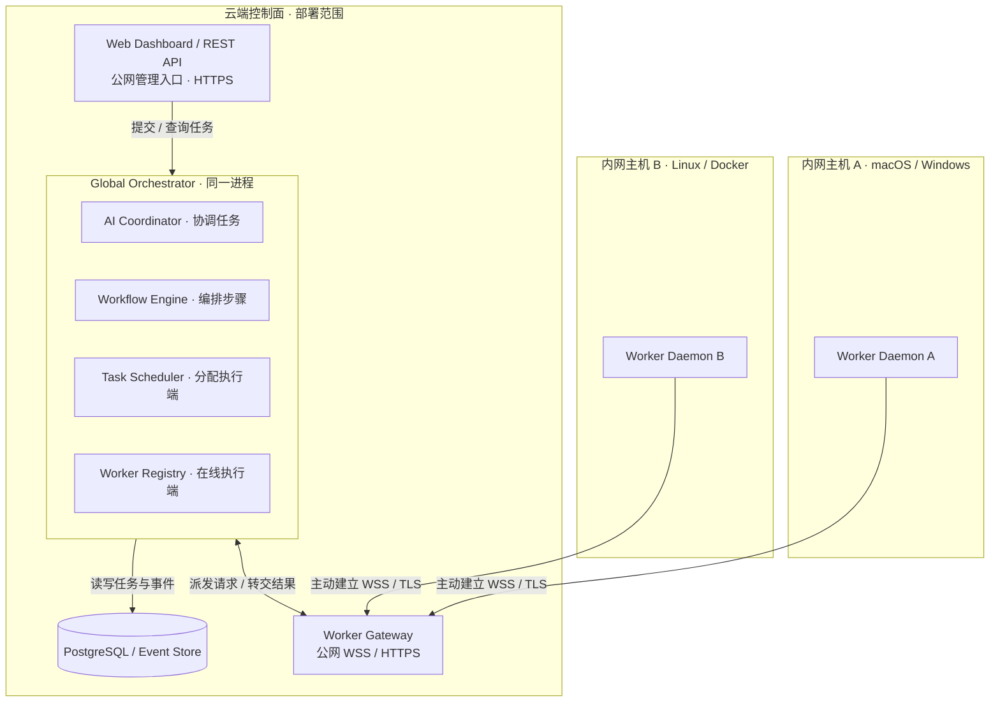
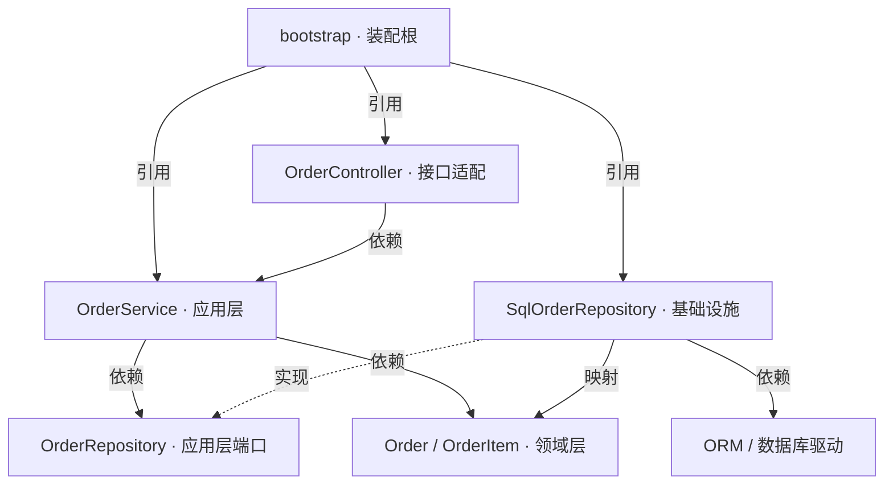
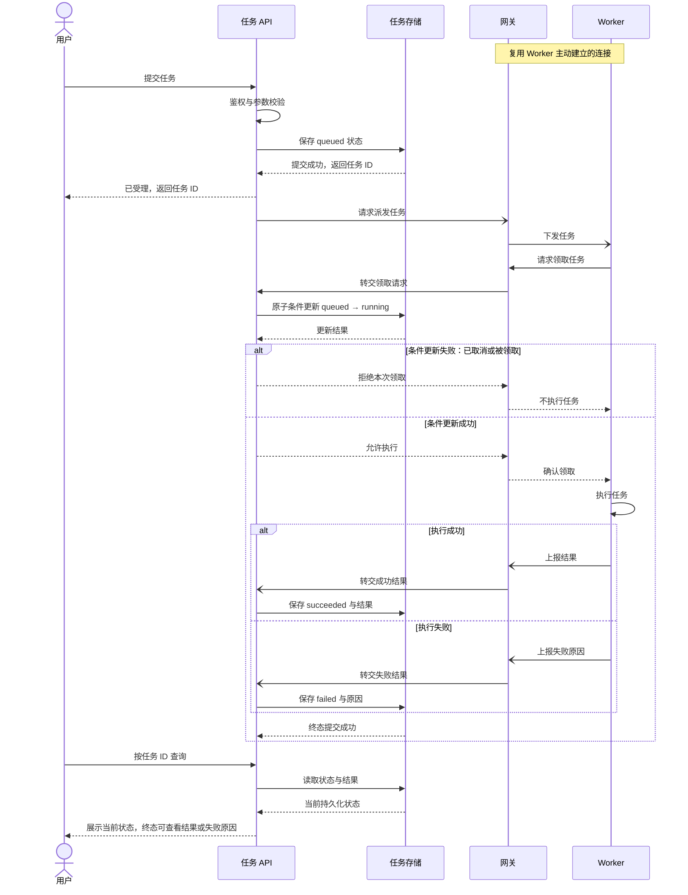
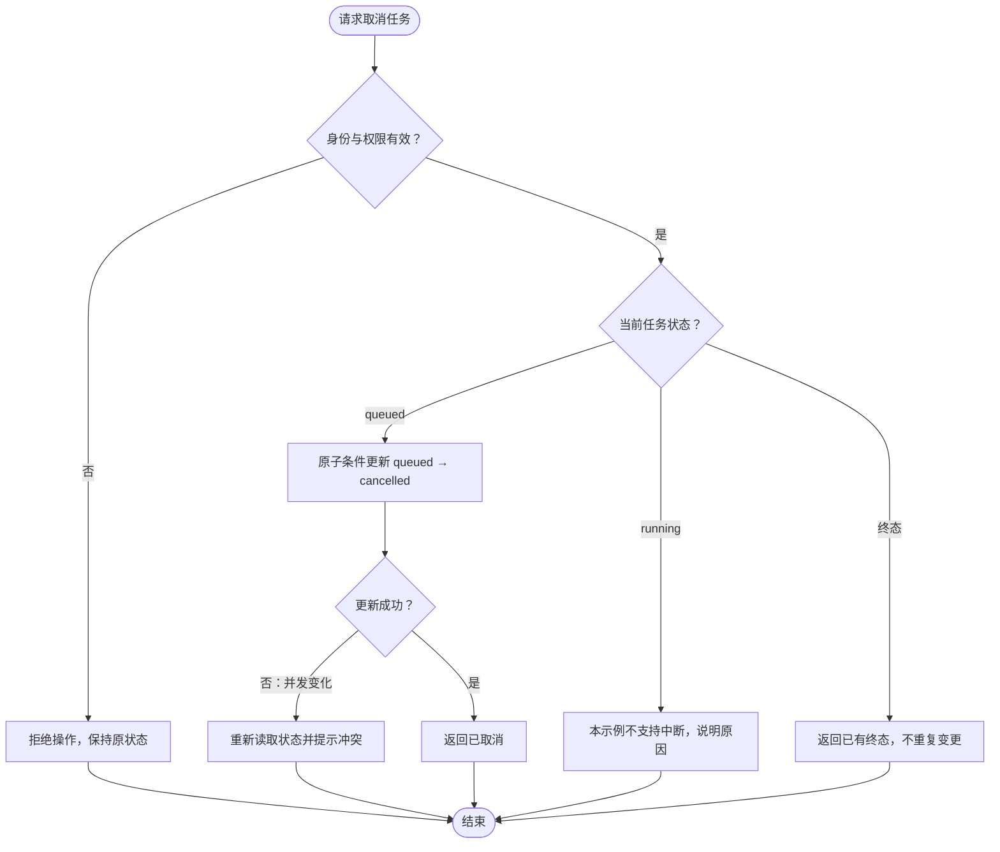
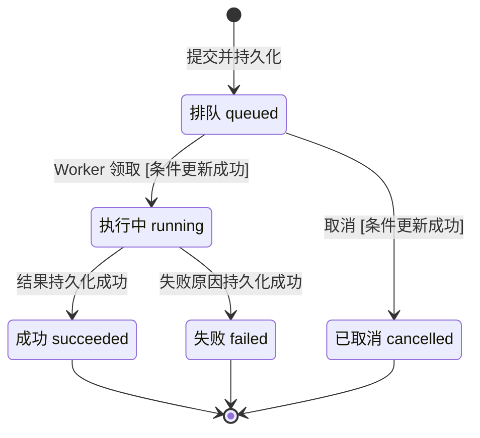
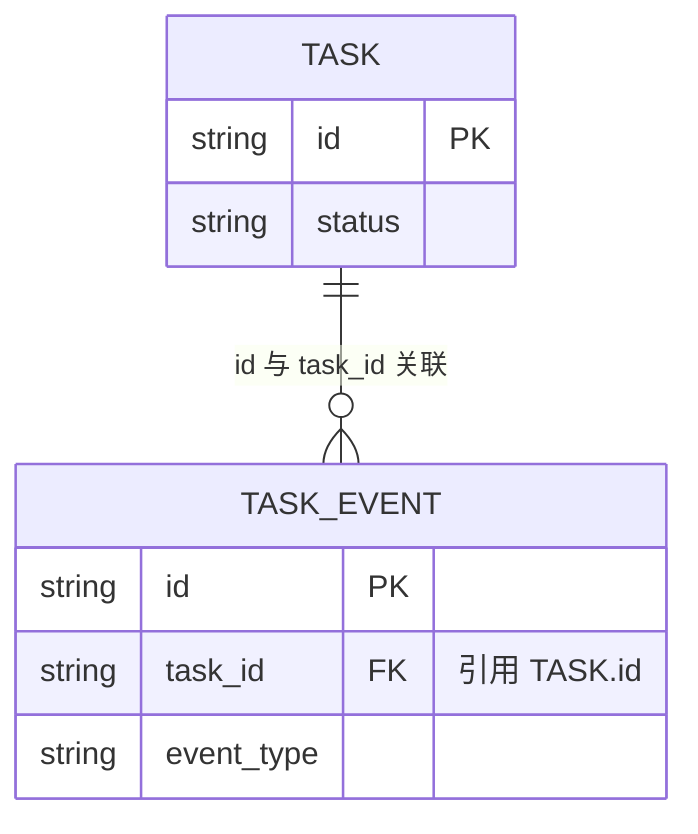
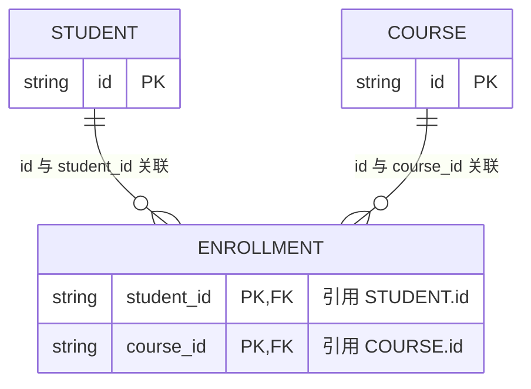
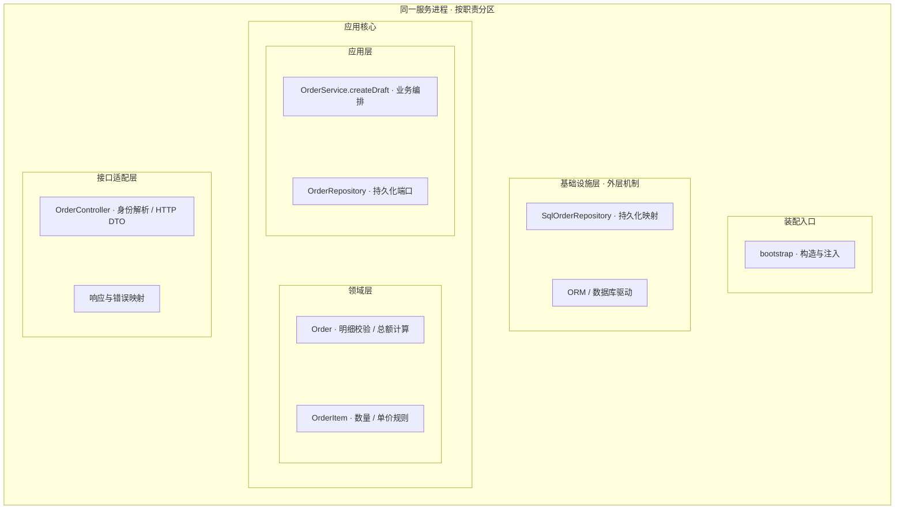
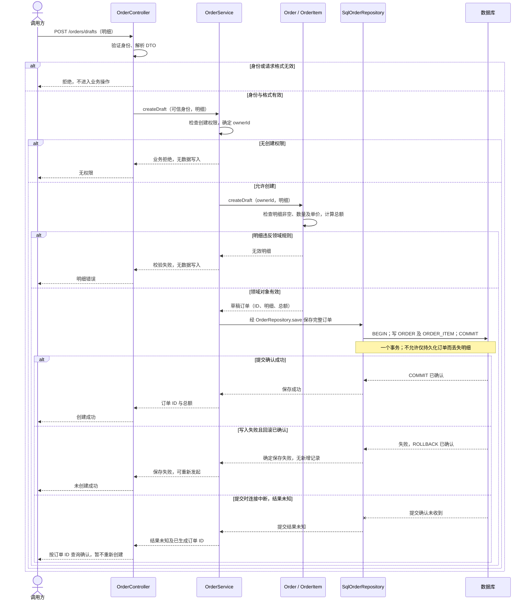
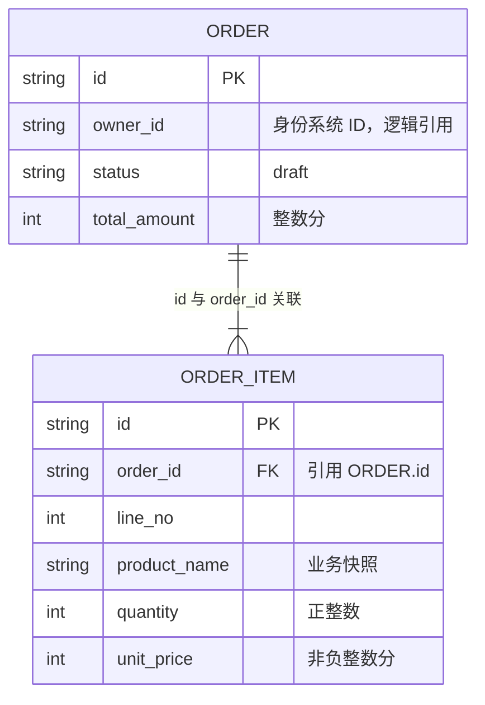

# 技术图示示例

以下均为虚构目标方案，只示范[图型选择与表达方法](../references/diagram-method.md)，不是本插件或某个项目的实际架构。采用时只保留本次需要的图，替换参与者、边界、协议、状态和失败语义；相邻正文补充源码/契约依据及相关 ARC/OUT，不将示例默认升级为项目要求。

## 分区、分层架构总览

问题：控制面与内网执行端各负责什么，如何通信？目标示意；外框分别代表云端控制面的部署范围和内网主机，控制面子框代表进程/运行单元，编排器内框代表同一进程中的逻辑组件。云端部署外框不表示内部数据库对公网暴露；管理入口和网关单独标明公网协议。包含不表示调用，带标签的边表示运行通信或数据访问。图省略内部网络划分、鉴权、重连与多副本细节。

数据库和网关并列；Worker 主动建立连接，任务下发与结果上报复用该通道，消息方向见正文关系表。

读图结论：控制面管理任务与调度，执行端在内网运行任务；连接由 Worker 发起，任务通过已建立连接下发。网络连通不证明鉴权或权限已实现，实际设计仍需给出相关契约。

### 不看图时的运行结构说明

以下仍为虚构目标，依据是本例设计约定；未对应项目源码。云端部署范围包含 Web Dashboard / REST API、编排服务进程、PostgreSQL / Event Store 和 Worker Gateway；Web与网关是公网入口，部署在云端不表示数据库对公网暴露。编排服务内部包含 AI Coordinator、Workflow Engine、Task Scheduler、Worker Registry 四个逻辑模块；主机A和主机B各包含一个Worker Daemon，操作系统示意分别为macOS/Windows、Linux/Docker。本图未定义这些模块的源码依赖、端口实现或具体注入方式，不能由布局推断。

| 关系类型 | 主体 → 对象 | 具体含义与条件 | 依据及状态 |
| --- | --- | --- | --- |
| 运行调用 | Web Dashboard / REST API → Global Orchestrator | 提交/查询任务；具体进程间协议未在本例约定 | 虚构目标；运行总览设计 |
| 数据访问 | Global Orchestrator → PostgreSQL / Event Store | 读写任务和事件；网关请求不以数据库作为必经转发节点 | 虚构目标；运行总览设计 |
| 双向运行协作 | Global Orchestrator ↔ Worker Gateway | 编排器请求派发，网关转交结果/连接状态 | 虚构目标；运行总览设计 |
| 主动建连 | 主机A的Worker、主机B的Worker → Worker Gateway | 各自主动建立WSS/TLS连接，无需内网开放入站端口 | 虚构目标；非源码依赖 |
| 通道消息 | Worker Gateway → Worker；Worker → Worker Gateway | 在已建立通道上分别下发任务、上报结果，TLS不自动说明双向身份认证 | 虚构目标；鉴权/重连另定 |

## 模块依赖图

问题：`OrderService` 怎样使用内层契约而不依赖 ORM？与后文订单分层图相同的虚构目标；实线箭头从依赖方指向被依赖模块/类型，虚线箭头从外层实现指向内层端口。装配根的实线只表示源码引用，实际注入行为见正文；图中方向不表示请求执行顺序。

装配根创建仓储实现并注入 Service；这与图中源码引用是不同关系，未另加注入边。接口适配依赖应用，应用依赖领域和自己拥有的端口，持久化适配实现端口并映射领域对象；实际代码不采用显式接口时按函数端口或真实符号改写。

读图结论：运行时 Service 经端口进入仓储实现，源码仍依赖内层契约。装配根可以引用外层实现，但应用层不能据此反向导入 ORM。

### 不看图时的源码、实现与注入关系

本表的名称与订单分层图、时序/ER一致，全部为虚构目标和占位源码位置。下面的箭头仅用于文字明确双方与方向，每行的关系类型独立解释；表中装配参数是本例新增的明确设计约定，不代表已有项目实现。本例SQL服务启动时，bootstrap先创建SqlOrderRepository实例，再构造OrderService(repository)并传入该仓储实例，随后构造OrderController(service)并传入该Service实例，最后注册路由；其他环境的实现选择未约定。

| 关系类型 | 主体 | 关系对象 | 具体含义、注入目标与条件 | 依据及状态（均为占位） |
| --- | --- | --- | --- | --- |
| 源码依赖 | bootstrap | OrderController、OrderService、SqlOrderRepository | 装配根引用三者的构造入口；创建和传入行为见下方注入行 | 示例 `bootstrap`；虚构目标 |
| 源码依赖 | OrderController | OrderService | Controller依赖应用业务入口，不直接读取持久化实现 | 示例 `adapters/http/OrderController`；虚构目标 |
| 源码依赖 | OrderService | OrderRepository | 依赖应用层自己拥有的保存/查询端口 | 示例 `application/OrderService`、`application/ports/OrderRepository`；虚构目标 |
| 源码依赖 | OrderService | Order / OrderItem | 使用领域对象及业务规则 | 示例 `application/OrderService`、`domain/Order`与`domain/OrderItem`；虚构目标 |
| 源码依赖 | SqlOrderRepository | Order / OrderItem | 持久化适配映射领域对象 | 示例 `infrastructure/SqlOrderRepository`；虚构目标 |
| 源码依赖 | SqlOrderRepository | ORM / 数据库驱动 | 技术库依赖留在基础设施层 | 示例 `infrastructure/SqlOrderRepository`；具体库未指定，虚构目标 |
| 端口实现 | SqlOrderRepository | OrderRepository（应用层拥有） | 外层持久化适配实现内层端口；与Service源码引用端口是两种关系 | 示例仓储实现与应用层端口；虚构目标 |
| 装配注入 | bootstrap | OrderService的构造参数repository | 创建SqlOrderRepository实例，作为OrderRepository传入Service；本例服务启动采用SQL实现，其他环境选择未约定 | 示例 `bootstrap`；参数名为本例约定，虚构目标 |
| 装配注入 | bootstrap | OrderController的构造参数service | 将已装配的OrderService实例传入Controller，再注册路由 | 示例 `bootstrap`；参数名为本例约定，虚构目标 |

关键限制：OrderService允许依赖领域与应用层端口，禁止导入SqlOrderRepository、ORM或HTTP框架类型；Order / OrderItem不依赖HTTP和数据库类型。运行时Service经端口进入仓储实现，这个调用不意味着源码反向依赖。示例采用构造参数装配；使用函数集合或工厂参数的项目按真实符号和条件表达，未使用DI容器并不构成缺层。

## 跨端协作时序图

问题：用户提交任务后，何时算受理，何时真正完成？目标示意；实线消息表示请求/调用，虚线表示响应，开放箭头表示不等待业务完成的异步消息。展示领取冲突和执行失败，鉴权失败、存储失败与连接中断另按实际契约展开。

读图结论：受理响应只证明排队记录已保存；查询时可能仍未结束，成功需执行完成且结果持久化。图中的异步派发不证明消息可靠交付；若存在可靠投递要求，设计必须补充丢失、重复及恢复机制。

## 条件决策流程图

问题：任务处于不同状态时能否取消？目标示意；菱形表示判断，边注明判断结果，矩形表示动作。这里只表达取消规则，实际参与者之间的调用顺序需另用时序图。

读图结论：仅排队任务可取消；并发启动可能使取消失败，条件更新防止覆盖已运行状态。这是示例规则，是否支持运行中取消由实际产品/执行契约决定。

## 生命周期状态图

问题：任务的合法状态转换是什么？与前两图一致的目标示意；框表示持久化状态，转换标注触发事件与条件，黑点表示初始或终止。没有出边的终态不允许原地重试，重试另建任务。

读图结论：取消只允许从 queued 进入 cancelled；终态不可回退。此图省略派发中间态与超时政策，真实项目不能据此推导其重试/恢复规则。

## 实体关系图

问题：任务和事件如何关联？目标示意；字段只列关系所需的键，连线注明基数；任务服务拥有这两类数据。完整字段、约束、删除和保留策略以项目 schema 为准。

读图结论：每个事件属于一个任务，一个任务可暂时没有事件。ER 图不说明事件投递顺序，也不证明采用事件溯源；需要这些保证时另写契约。

| 引用方 → 被引用方 | 关系类型与目标键 | 基数及约束 | 依据与状态 |
| --- | --- | --- | --- |
| `TASK_EVENT.task_id` → `TASK.id` | 数据库 FK → 主键 | 一个任务对应零至多条事件；事件必须属于一个任务，`task_id` 非空；删除/更新规则未约定 | 虚构目标设计，非已有 schema |

### 多对多与关联表示例

以下为独立虚构目标：学生可以选修多门课程，课程可以有多名学生；通过选课表表示实际关联。组合主键只允许同一学生与课程出现一条选课记录；删除/更新规则未约定。

| 引用方 → 被引用方 | 关系类型与目标键 | 基数及约束 | 依据与状态 |
| --- | --- | --- | --- |
| `ENROLLMENT.student_id` → `STUDENT.id` | 数据库 FK → 主键 | 学生对应零至多条选课记录；每条记录属于一个学生，字段非空 | 虚构目标设计 |
| `ENROLLMENT.course_id` → `COURSE.id` | 数据库 FK → 主键 | 课程对应零至多条选课记录；每条记录属于一门课程，字段非空 | 虚构目标设计 |

`ENROLLMENT` 的组合主键为 `(student_id, course_id)`；它是两字段组成的唯一性约束，不表示两个独立字段各自唯一。

## 服务端整洁架构分层与业务数据示例

以下分层图、对应的[模块依赖图](#模块依赖图)、业务时序及 ER 图描述同一个虚构的“创建草稿订单”目标方案，供[服务端架构视图](../../../agents/references/architecture/technical-diagrams.md#服务端架构视图)改写使用，未对应任何真实项目。示例代码位置及 schema 名称也均为占位；采用时替换为已核验的源码/契约，并标明版本与覆盖。逻辑层均属于同一服务进程，分层不表示拆分部署。

### 分层图及职责映射

问题：接口适配、应用、领域、基础设施和装配各负责什么？目标示意；外框代表同一服务进程，内部框只表示逻辑归属。分层图不画依赖/调用边，隐藏连接仅用于排版；具体源码关系见[独立模块依赖图](#模块依赖图)，运行时读写见后文时序图。

应用和领域置于核心区，基础设施位于外部适配区；装配入口负责创建及注入。直接使用 `CreateDraftOrderUsecase` 的项目保留其真实名称，不额外新增 Service 转调层。

| 层次 | 示例职责与代码位置（均为占位） |
| --- | --- |
| 接口适配 | `adapters/http/OrderController.createDraft` 解析可信身份与请求格式，将业务错误映射为 HTTP 结果 |
| 应用 | `application/OrderService.createDraft` 检查用例权限、调用领域构造、经本层 `ports/OrderRepository` 保存；不导入 ORM |
| 领域 | `domain/Order.createDraft` 校验至少一条明细、数量为正整数、单价为非负整数分，计算总额；`OrderItem` 不依赖 HTTP 或数据库类型 |
| 基础设施 | `infrastructure/SqlOrderRepository.save` 将领域订单映射到 ORDER/ORDER_ITEM，在一个数据库事务中保存，提交确认后才返回成功 |
| 装配 | `bootstrap` 创建仓储实现并注入 Service，再注册 Controller；只负责装配，不决定业务规则 |

读图结论：Service 通过自己所需的端口使用外部持久化能力，运行调用进入仓储实现，源码依赖仍向内。项目若直接使用 `CreateDraftOrderUsecase.execute`，替换应用层名称即可，无需同时增加 Service 与 Usecase 两个转调层。

无图分层结论：同一服务进程包含接口适配层、应用核心、基础设施层及装配入口；应用核心包含应用层和领域层。OrderController及响应/错误映射属于接口适配层；OrderService和由应用层拥有的OrderRepository属于应用层；Order与OrderItem属于领域层；SqlOrderRepository和ORM/数据库驱动属于基础设施层；bootstrap属于装配入口。各层职责/占位代码见上表，源码依赖、端口实现与两个构造参数注入关系统一见[文字关系清单](#不看图时的源码实现与注入关系)（本例同一虚构目标版本），不另复制第二份关系事实。

### 业务操作清单与具体时序

| 业务操作/入口 | Service 及方法 | 输入、结果与错误 | 领域规则/协作 | 时序与模型 |
| --- | --- | --- | --- | --- |
| 创建草稿订单 / `POST /orders/drafts` | `OrderService.createDraft` | 可信身份、明细 → 草稿订单 ID/总额；拒绝、无效明细、确定保存失败、提交结果未知 | `Order.createDraft`；`OrderRepository.save` 原子保存订单及明细 | 下图；ORDER/ORDER_ITEM，示例 `schema/order.sql` |

问题：这个 Service 具体执行什么规则，何时能够返回成功？前置条件是 Controller 已完成身份验证和请求格式检查；Service 继续核对用例权限，示例不接受请求体自行指定订单拥有者。实线为同步调用，虚线为响应；参与者“仓储实现”是运行时注入的端口实现，不表示应用源码直接引用它。

读图结论：成功响应以仓储提交确认为前提；权限或领域拒绝不触发写入。提交结果未知时通过另行定义的鉴权查询 `OrderRepository.findById` 确认，查询暂未找到也不能在原事务仍可能提交时直接认定失败；只有最终结果确认后再决定下一动作。图仅展开创建链路，查询链路、身份系统内部步骤和具体驱动事务指令省略；不承诺自动重试、幂等或网络故障后一定回滚。采用时按项目真实恢复契约补齐。

### 数据模型关系与 ER 图

问题：此业务操作最终保存哪些关联数据，由谁保证关系？下图是示例持久化模型，ORDER 映射领域 `Order`，ORDER_ITEM 映射其明细；订单域拥有二者，`SqlOrderRepository` 负责读写。键和字段是虚构契约，不是现有数据库事实。

读图结论：每条明细属于且仅属于一个订单，每个成功创建的草稿订单至少有一条明细；领域校验和原子保存共同保证这一要求。`order_id` 在示例中是真实 FK，`owner_id` 仅逻辑引用身份系统，不声明跨库外键。完整约束以采用后的权威 schema 为准。

| 引用方 → 被引用方 | 关系类型与目标键 | 基数及约束 | 依据与状态 |
| --- | --- | --- | --- |
| `ORDER_ITEM.order_id` → `ORDER.id` | 数据库 FK → 主键 | 每条明细属于一个订单，`order_id` 非空；订单至少一条明细由业务规则保证；删除/更新规则未约定 | 示例 `schema/order.sql`，虚构目标 |
| `ORDER.owner_id` → 身份系统目标字段待定 | 逻辑引用；目标键待定 | 拥有者来自可信身份；字段可空及目标约束待设计，不声明数据库 FK | 虚构目标，身份系统契约未指定 |

| 关键约束/生命周期 | 示例责任与依据 |
| --- | --- |
| ORDER.id、ORDER_ITEM.id 唯一；同一订单 line_no 唯一 | 示例 schema 主键及 `UNIQUE(order_id, line_no)`；仓储遵守数据库约束 |
| 订单至少一条明细，数量/单价合法，总额等于明细金额之和 | `Order.createDraft` 领域不变量；`OrderRepository.save` 整体原子保存，不能仅凭 FK 声称全部得到保证 |
| 创建结果 status=draft，拥有者来自可信身份 | Service 确定拥有者，领域构造草稿；创建失败按时序区分回滚确认与结果未知 |
| 明细依附订单整体保存，产品名称/单价为业务快照 | 本例无独立明细删除操作；订单删除、后续状态迁移及保留期限不在本示例范围，真实设计须按需求说明 |

三图交叉核对：操作清单中的 `OrderService.createDraft` 对应分层图应用层和时序主编排者；时序保存的订单及明细对应 ER 两实体，原子性由仓储端口契约承接。ER 不表达事务先后，分层图不表达调用时间，时序参与者也不自动成为独立部署单元。
